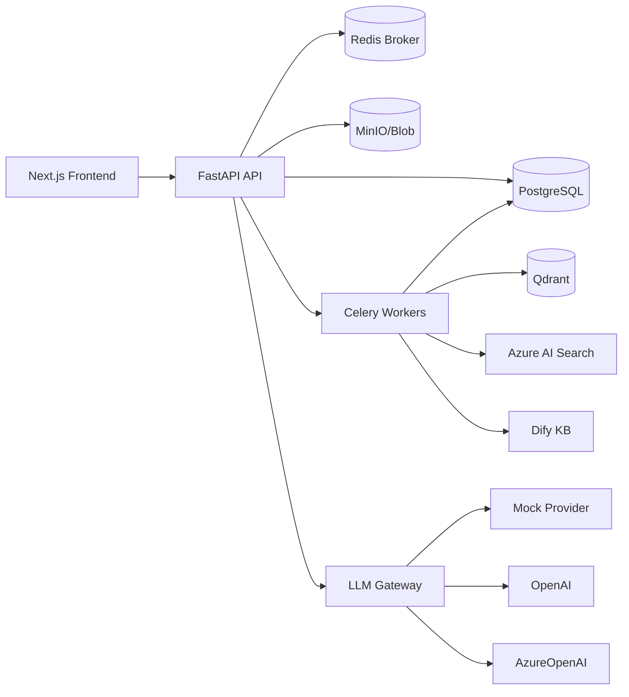
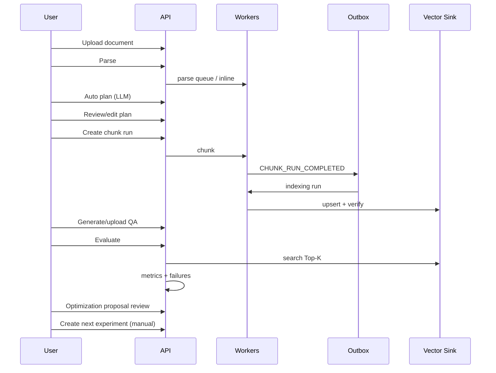

# Architecture

## Component diagram

## Sequence: parse → chunk → index → evaluate → optimize

## Canonical schema

`CanonicalChunk` v1.0.0 groups identity, content, measurements, source locators, relationships, strategy, decision evidence, quality, indexing, and extensions. Library-specific fields belong under `extensions.provider_payload`.

## Configuration precedence

1. Hard environment constraint  
2. Tenant policy  
3. Manual region override  
4. Manual logical-unit override  
5. Manual document configuration  
6. LLM Auto recommendation  
7. Environment default  

Invalid manual values are rejected with structured errors (never silently clamped).

## Evidence model

Append-only `AuditEvent` records plus `ProviderManifest` and `ReproductionManifest`. Production candidacy requires a complete reproduction manifest.

## Deployment architecture

Local: Docker Compose.  
Production: Azure Container Apps revisions consuming the same images, secrets via Key Vault references, managed identities where possible.

## Failure boundaries

- Optional sink failure does not roll back other sinks (`PARTIAL`).
- Parser / QA ground-truth / indexing integrity failures are not treated as chunk-size optimization opportunities.
- Optimization never auto-executes.
