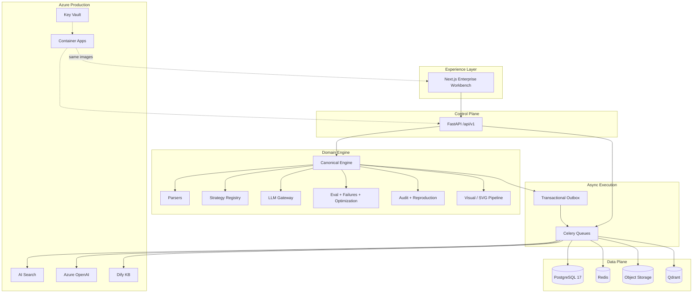

<p align="center">
  
</p>

<p align="center">
  <strong>Enterprise-grade adaptive chunking, retrieval evaluation, and optimization governance for production RAG.</strong><br/>
  Canonical schemas · Human-in-the-loop control · Full audit & reproduction evidence · Azure-ready
</p>

<p align="center">
  <a href="#-60-second-start"></a>
  <a href="ARCHITECTURE.md"></a>
  <a href="SECURITY.md"></a>
  <a href="docs/adr"></a>
  <a href="#-technology-stack"></a>
  <a href="#-technology-stack"></a>
  <a href="#-azure-production-path"></a>
</p>

<p align="center">
  <a href="#-中文简介">中文简介</a> ·
  <a href="#-why-enterprises-choose-this">Why enterprises</a> ·
  <a href="#-core-capabilities">Capabilities</a> ·
  <a href="#-60-second-start">Quick start</a> ·
  <a href="#-integration-matrix">Integrations</a> ·
  <a href="FINAL_REPORT.md">Verification report</a>
</p>

---

## 中文简介

**Adaptive Chunk Engine（ACE）** 是面向企业 RAG 生产落地的 **自适应切块、检索评估与优化治理平台**。

它不是“再封装一层切块库”，而是把企业真正关心的能力做成完整产品闭环：

| 企业诉求 | ACE 交付 |
|---------|---------|
| 可审计、可复现 | 决策 / 执行 / 评估 / 变更证据链 + Reproduction Manifest |
| 人工可控优化 | LLM 可提议，**永不自动执行**下一轮实验 |
| 多源文档与复杂表格 | PDF / Office / Markdown / 图像 / **原生 Excel 区域切块** |
| 多向量库与知识库 | Qdrant · Azure AI Search · Dify Knowledge Base |
| 生产级部署 | Docker Compose 本地同构 · Azure Container Apps + Key Vault |
| 合规与隔离 | 租户字段、密钥写后不可读、开发鉴权明确标注非生产 |

> **一句话**：用可治理的实验闭环，把“切块玄学”变成可度量、可复盘、可上线的企业工程能力。

---

## Why enterprises choose this

Most RAG projects fail after the demo — not because the model is weak, but because **chunking is opaque, evaluation is ad-hoc, and nobody can reproduce what shipped**.

Adaptive Chunk Engine is built for organizations that need:

1. **Governance over guesswork** — every Auto decision, human override, and metric gate leaves durable evidence.
2. **Measurable retrieval quality** — configurable metrics, hard gates, and a weighted composite score (**Evaluation Accuracy**).
3. **Controlled optimization** — localized JSON Patch proposals; next experiment starts **only** after explicit human action.
4. **Provider independence** — canonical chunk schema; library-specific payloads never leak as the primary API contract.
5. **Cloud production path** — same container images locally and on Azure; secrets via Key Vault; managed-identity-ready design.

### Enterprise architecture diagram

<p align="center">
  
</p>



---

## Enterprise guarantees

| Guarantee | How it is enforced |
|-----------|-------------------|
| **No silent auto-optimization** | `OPTIMIZATION_REQUIRE_HUMAN_TRIGGER=true` — proposals cannot publish or start the next round alone |
| **No silent clamping** | Invalid manual parameters return structured validation errors |
| **No fake provider success** | Unavailable adapters report health + reason; mocks are explicitly named |
| **No secret leakage** | Credential references are write-only; audit snapshots redact secrets |
| **No unnormalized chunks** | Core API returns **CanonicalChunk v1.0.0** only |
| **No production without reproducibility** | Production candidacy requires a complete **ReproductionManifest** |
| **Partial sink failure isolation** | One optional destination failure does not roll back others |

---

## Core capabilities

### Document intelligence
- Formats: **PDF · DOCX · PPTX · XLSX/XLS · CSV · Markdown · TXT · PNG/JPEG/TIFF**
- Canonical model: `Document → LogicalUnit → Region → Element`
- Page-aware but **not page-isolated** — preserves cross-unit continuations
- Docling preferred path with local fallbacks (PyMuPDF, python-docx, python-pptx, openpyxl, pandas, markdown-it-py, Pillow/OCR interface)
- No mandatory external network call for local parsing

### Adaptive chunking
- Plugin **Strategy Registry** with capabilities, JSON parameter schemas, license metadata, and health status
- 30+ registered strategies including fixed token, recursive, sentence window, heading, parent-child, table atomic/row-group, markdown structural, spreadsheet, and Excel-native strategies
- Per-document / per-logical-unit / per-region configuration with **Auto | Manual** field modes
- Strict configuration precedence: environment → tenant → region → unit → document → LLM Auto → default

### Excel-native RAG (enterprise differentiator)
Not “dump the sheet to text.” ACE supports worksheet profiling, contiguous regions, merged cells, formulas, named ranges, and locators such as:

```text
file.xlsx#SheetName!A1:F18
```

Fully implemented strategies include `excel_table_row_group`, `excel_record_per_row`, `excel_region`, and `excel_formula_dependency`, with spreadsheet-range evidence coverage for evaluation.

### QA dataset factory
- Generate grounded QA with configurable count and type distribution
- Upload incomplete QA (question + answer only) → schema completion against **source evidence only**
- Invented element IDs / locators are rejected; low-confidence items flagged for review

### Retrieval evaluation & failure analysis
- Metrics: Evidence Recall@K, MRR, nDCG, LU/Element Recall, Precision, Duplicate Rate, Orphan Evidence, token efficiency, chunk count, and more
- Weighted **composite_retrieval_score** (UI: *Evaluation Accuracy*) with independent hard gates
- Three-stage hit matching: element ID → span/coverage → optional semantic fallback
- Rule-first failure taxonomy across PARSER / CHUNKING / INDEXING / RETRIEVAL / QA_GROUND_TRUTH

### Optimization governance
- Localized JSON Patch proposals (not full-plan rewrites by default)
- Stopping recommendations (`ACCEPT`, `STOP_NO_MEANINGFUL_HEADROOM`, `REGRESSION`) — **recommendation only**
- Explicit human review: accept / edit / reject → create next experiment

### Visual processing (optional)
- OCR, captions, geometric SVG tracing, semantic scene-graph reconstruction
- SVG sanitization allowlist (no scripts, event handlers, foreignObject, remote refs)
- Searchable visual chunk types without indexing raw SVG XML by default

### Indexing & destinations
- Transactional outbox: successful chunk runs emit `CHUNK_RUN_COMPLETED`
- Asynchronous indexing lifecycle: `PENDING → … → READY | PARTIAL | FAILED`
- Sinks: **Qdrant** (local), **Azure AI Search**, **Dify Knowledge Base** (+ stubs for pgvector, Milvus, OpenSearch, Pinecone, Weaviate, generic REST)

---

## Platform surface

| Layer | What you get |
|-------|----------------|
| **Control plane** | FastAPI `/api/v1` + OpenAPI, correlation IDs, structured errors |
| **Workbench** | Next.js UI: strategy workbench, QA manager, evaluation dashboard, failure analysis, optimization review, connections, audit |
| **Workers** | Celery queues: parse · chunk · qa · embedding · indexing · evaluation · optimization |
| **Contracts** | JSON Schema, OpenAPI, event schemas, generated TypeScript types |
| **Evidence** | Decision / execution / evaluation / change evidence + audit trail |
| **Ops** | Compose local stack, Bicep for Azure, GitHub Actions + Azure DevOps example |

---

## Technology stack

| Domain | Choice |
|--------|--------|
| Bootstrap | Docker Compose |
| API | Python 3.12 · uv · FastAPI · SQLAlchemy 2.x async · Alembic · Pydantic v2 |
| Workers | Celery + Redis (Temporal / Azure Service Bus migration interfaces prepared) |
| Frontend | Next.js · TypeScript · pnpm · Tailwind · accessible React UI |
| Data | PostgreSQL 17 · Redis · MinIO/S3-compatible · Qdrant |
| Production | Azure Container Apps · Flexible Server · Blob · Key Vault · AI Search · App Insights |
| LLM | OpenAI · Azure OpenAI · deterministic mock for offline / CI |

---

## 60-second start

```bash
git clone https://github.com/John-Maximilian-Liu/Adaptive-Chunk-Engine.git
cd Adaptive-Chunk-Engine
cp -n .env.example .env
docker compose up -d --build
```

| Service | URL |
|---------|-----|
| **Enterprise workbench** | http://localhost:3000 |
| **API & OpenAPI** | http://localhost:8000/docs |
| **Liveness** | http://localhost:8000/api/v1/health/live |
| **Readiness** | http://localhost:8000/api/v1/health/ready |
| Qdrant | http://localhost:6333 |

> On some nested/cloud VMs, if containers cannot reach each other:  
> `./scripts/fix-docker-bridge-forwarding.sh` then restart Compose.

### First enterprise workflow

1. Open the workbench → confirm system health  
2. `POST /api/v1/admin/seed` (or rely on startup seed) — tenant, mock LLM/embedding, Qdrant sink, evaluation profile, **no external API keys required**  
3. Upload a document → parse → auto-generate chunk plan  
4. Review / lock strategies per logical unit or region  
5. Run chunking → automatic indexing outbox → verify Qdrant  
6. Generate or upload QA → evaluate → inspect failures  
7. Review optimization proposal → **manually** create the next experiment  

```bash
# Seed
curl -s -X POST http://localhost:8000/api/v1/admin/seed | jq .

# List strategies (health + availability)
curl -s http://localhost:8000/api/v1/strategies \
  -H 'X-Tenant-Id: tenant_dev' | jq '.[].strategy_id'

# Upload
curl -s -X POST http://localhost:8000/api/v1/documents \
  -H 'X-Tenant-Id: tenant_dev' \
  -F file=@tests/fixtures/sample.md | jq .
```

---

## Integration matrix

| Integration | Role | Status |
|-------------|------|--------|
| **OpenAI** | Chat / structured JSON / embeddings | Implemented (API-key profiles) |
| **Azure OpenAI** | Same + deployment / Entra / managed-identity-ready config | Implemented |
| **Mock LLM** | Deterministic offline / CI / demo | Operational (default seed) |
| **Qdrant** | Local engine-managed vectors | Operational |
| **Azure AI Search** | Production primary vector destination | Implemented + contract-tested |
| **Dify Knowledge Base** | External KB segments (sink-managed embeddings) | Implemented + contract-tested |
| **Docling** | Preferred parser when installed | Optional preferred path |
| **Builtin + Excel strategies** | Core deterministic chunking | Operational |
| Optional libraries (Chonkie, Chunkana, Chunkr, zchunk, …) | Extended adapters | Honest degrade + enablement docs |

Secrets are **never** returned by the frontend after save.

---

## Security & compliance posture

Designed for regulated RAG programs — see [SECURITY.md](SECURITY.md).

- File size / MIME / extension / signature checks, safe filenames  
- Tenant isolation fields and authorization hooks  
- Secret redaction in logs and audit snapshots  
- CORS + secure headers + request correlation IDs  
- Microsoft Entra ID placeholders for production auth  
- Local `AUTH_MODE=development` is **explicitly not production-safe**  
- SVG sanitization for visual artifacts  

---

## Azure production path

Same images as local Compose. Deploy via Bicep:

```bash
az bicep build -f infrastructure/bicep/main.bicep
# parameter files: infrastructure/environments/{dev,test,prod}.parameters.json
```

Provisioned / referenced components include Container Apps Environment, ACR, PostgreSQL Flexible Server, Redis, Blob, Service Bus (migration target), Key Vault, Azure OpenAI references, Azure AI Search, Application Insights, and Log Analytics — with managed identity and Key Vault secret references where applicable.

**Do not** run Docker Compose as production.

---

## Quality & verification

| Gate | Evidence |
|------|----------|
| One-command local stack | `docker compose up -d --build` |
| Automated tests | pytest (unit / contract / integration / security) · Vitest · Playwright scaffold |
| Contracts | Canonical JSON Schema + OpenAPI |
| Architecture decisions | [10 ADRs](docs/adr) |
| Verification dossier | [FINAL_REPORT.md](FINAL_REPORT.md) |

```bash
# Backend
cd apps/api && export PYTHONPATH=.:../../packages/python
pytest -q

# Frontend
cd apps/web && pnpm install && pnpm test && pnpm typecheck
```

---

## Repository map

```text
apps/api          FastAPI control plane, Alembic, Docker images
apps/web          Next.js enterprise workbench
workers/          Celery workers by domain queue
packages/python/  Canonical schemas, parsers, adapters, eval, audit, visual
packages/typescript/  API client + generated schemas + UI kit
contracts/        JSON Schema · OpenAPI · events
infrastructure/   Azure Bicep + pipeline examples
tests/fixtures/   Synthetic multi-format documents
```

---

## Documentation

| Document | Purpose |
|----------|---------|
| [ARCHITECTURE.md](ARCHITECTURE.md) | Components, sequences, precedence, failure boundaries |
| [SECURITY.md](SECURITY.md) | Auth, secrets, upload hardening, production checklist |
| [CONTRIBUTING.md](CONTRIBUTING.md) | Engineering conventions |
| [IMPLEMENTATION_PLAN.md](IMPLEMENTATION_PLAN.md) | Milestone checklist |
| [FINAL_REPORT.md](FINAL_REPORT.md) | Verification results & limitations |
| [docs/adr](docs/adr) | Architecture Decision Records |

---

## Known limitations (transparent by design)

Enterprise trust requires honesty:

- Live OpenAI / Azure / Dify / AI Search connectivity is verified with **mocks/contracts** unless credentials are supplied in your environment  
- Optional chunk providers are marked unavailable until dependencies are installed — never falsely reported healthy  
- Local object storage may use S3-compatible **S3Mock** when MinIO images are unavailable  
- Development auth must be replaced before production  

---

## Star · Fork · Ship

If you are building **enterprise RAG** and are tired of ungoverned chunking experiments:

1. **Star** this repository to follow the platform  
2. **Fork** and run `docker compose up -d --build`  
3. Open an issue with your evaluation profile / sink requirements  
4. Contribute adapters behind the Strategy Registry / VectorSink contracts  

<p align="center">
  <strong>Adaptive Chunk Engine</strong> — make retrieval quality an engineered, auditable enterprise capability.<br/>
  <em>Chunk with evidence. Evaluate with gates. Optimize with humans in control.</em>
</p>
