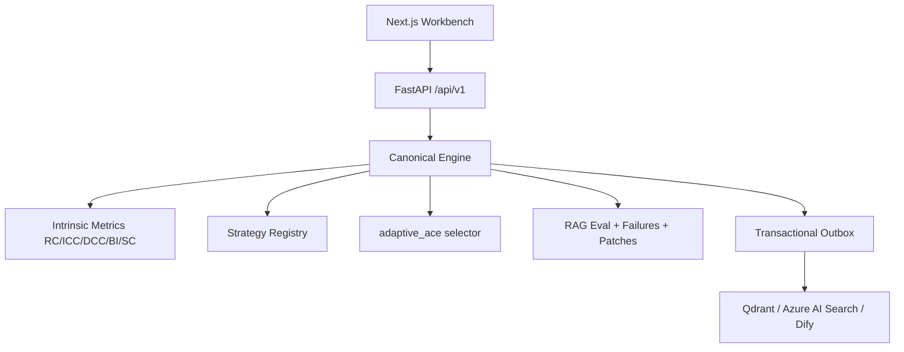

<div align="center">

# Adaptive Chunk Engine

**Governed, per-document adaptive chunking for enterprise RAG**

[](https://arxiv.org/abs/2603.25333)
[-blue.svg)](https://github.com/ekimetrics/adaptive-chunking)
[](https://www.python.org/downloads/)
[](https://nextjs.org/)
[](infrastructure/bicep/main.bicep)
[](FINAL_REPORT.md)


</div>

---

> **Enterprise control plane** for metric-guided chunking selection, retrieval evaluation, and human-governed optimization.  
> Evaluation protocol adapted from *Adaptive Chunking: Optimizing Chunking-Method Selection for RAG* ([arXiv:2603.25333](https://arxiv.org/abs/2603.25333), LREC 2026) and the official code at [ekimetrics/adaptive-chunking](https://github.com/ekimetrics/adaptive-chunking).  
> Full ACE study: [`papers/ace_adaptive_chunking_evaluation.md`](papers/ace_adaptive_chunking_evaluation.md) · raw tables: [`results/adaptive_chunking_eval/tables.md`](results/adaptive_chunking_eval/tables.md)

## 中文简介

**Adaptive Chunk Engine（ACE）** 把 LREC 2026 *Adaptive Chunking* 的「按文档选择最优切块策略」思想产品化：在 **RC / ICC / DCC / BI / SC** 五类内在指标驱动下做自适应选择，并补齐企业落地所需的 **审计证据、人工优化门禁、Excel 原生切块、多向量库同步与 Azure 部署**。

---

## What is Adaptive Chunk Engine?

No single chunking method wins on every document. The Adaptive Chunking paper shows how to **score strategies with intrinsic metrics and pick the best method per document**, improving RAG without changing the generator ([arXiv:2603.25333](https://arxiv.org/abs/2603.25333)).

**ACE industrializes that idea:**

| Research idea (LREC 2026) | ACE productization |
|---------------------------|--------------------|
| Per-document strategy selection | Strategy Registry + Auto/Manual field modes + precedence |
| Five intrinsic metrics | `evaluation_engine.intrinsic_metrics` + Failure Analysis Workbench |
| Recursive / page / LLM-regex splitters | Built-in + Excel-native + optional provider adapters |
| RAG evaluation | Composite score, hard gates, evidence hit matching |
| Research reproducibility | Audit events + ReproductionManifest + Docker/Azure packaging |

---

## Key Results (ACE offline evaluation)

Protocol inspired by Tables 3 & 5 of [ekimetrics/adaptive-chunking](https://github.com/ekimetrics/adaptive-chunking).  
Corpus: **6 documents · 3 domains (technical / legal / sustainability) · ≈8.8k words**.  
Selector: `adaptive_ace` = per-document argmax of intrinsic mean over ACE builtins.  
Reproduce: `python scripts/run_adaptive_chunking_eval.py`

### Intrinsic metrics (Table 3 style, %)

| Method | RC | ICC | DCC | BI | SC | **Mean** |
|--------|---:|----:|----:|---:|---:|--------:|
| **adaptive_ace** | 100.0 | 63.55 | 99.90 | 100.0 | 100.0 | **92.69** |
| recursive_text_1100 | 100.0 | 63.52 | 99.93 | 100.0 | 100.0 | **92.69** |
| recursive_text | 100.0 | 63.57 | 99.89 | 98.70 | 100.0 | 92.43 |
| fixed_token_512 | 100.0 | 62.94 | 99.91 | 97.66 | 100.0 | 92.10 |
| fixed_token_256 | 99.25 | 62.07 | 99.54 | 96.69 | 99.02 | 91.31 |
| heading_section | 100.0 | 62.50 | 93.73 | 97.66 | 83.33 | 87.44 |
| no_split | 100.0 | 63.48 | 100.0 | 100.0 | 16.67 | 76.03 |
| sentence_window | 58.33 | 63.93 | 95.05 | 21.35 | 60.69 | 59.87 |

### RAG-lite evaluation (Table 5 style)

| Method | Retrieval Completeness | Answer Correctness | Answered queries |
|--------|-----------------------:|-------------------:|-----------------:|
| **adaptive_ace** | **100.0** | **100.0** | 43/43 |
| recursive_text_1100 | 100.0 | 100.0 | 43/43 |
| recursive_text | 100.0 | 100.0 | 43/43 |
| fixed_token_512 | 100.0 | 100.0 | 43/43 |
| heading_section | 100.0 | 100.0 | 43/43 |
| no_split | 100.0 | 100.0 | 43/43 |
| fixed_token_256 | 99.89 | 99.87 | 43/43 |
| sentence_window | 91.48 | 89.84 | 43/43 |

**Takeaway:** Adaptive selection recovers the best fixed strategy’s intrinsic mean and avoids brittle splitters that destroy block integrity / reference completeness—the same qualitative conclusion as the LREC paper, now inside an enterprise control plane.

> Published CLAIR-scale numbers from the paper (33 docs, neural embeddings, LLM judge): Adaptive Chunking **91.07** mean intrinsic · **67.7 / 78.0** RAG completeness / correctness. ACE offline scores use hashed embeddings + lexical judges; **compare ranks, not absolute RAG magnitudes**.

---

## Evaluation Metrics

Five intrinsic metrics (paper-aligned) score chunkings **without ground-truth answers**:

| Metric | What it measures |
|--------|------------------|
| **Size Compliance (SC)** | Fraction of chunks inside target token bounds |
| **Intrachunk Cohesion (ICC)** | Similarity of sentence blocks to the chunk embedding |
| **Contextual Coherence (DCC)** | Similarity of each chunk to its local context window |
| **Block Integrity (BI)** | Structural blocks (paragraphs / sections) kept intact |
| **References Completeness (RC)** | Pronoun–antecedent pairs not broken across boundaries |

Implemented in [`packages/python/evaluation_engine/intrinsic_metrics.py`](packages/python/evaluation_engine/intrinsic_metrics.py). ICC/DCC default to deterministic hashed n-grams for offline CI; plug in Jina / SentenceTransformers via `embed_fn` for semantic parity with the paper.

ACE additionally exposes **evidence-based RAG metrics** (Recall@K, MRR, nDCG, hard gates, composite *Evaluation Accuracy*) in the product evaluation engine.

---

## Default Chunking Methods (ACE Registry)

| Method | Description |
|--------|-------------|
| **adaptive_ace** | Per-document selection by intrinsic mean (paper-style) |
| **recursive_text (512 / 1100)** | Recursive splitter with ACE hard constraints |
| **fixed_token** | Fixed token windows with overlap validation |
| **sentence_window** | Sentence-aware windows |
| **heading_section** | Heading-bounded sections |
| **Excel-native** | `excel_table_row_group`, `excel_record_per_row`, `excel_region`, `excel_formula_dependency` |
| **Optional providers** | Docling hierarchical/hybrid, Chonkie, Chunkana, Chunkr, zchunk (honest degrade) |

---

## Enterprise guarantees

| Guarantee | Enforcement |
|-----------|-------------|
| No silent auto-optimization | Next experiment requires explicit human action |
| No silent clamping | Invalid manual params → structured errors |
| No fake provider success | Unhealthy adapters report reasons |
| No secret leakage | Write-only credential refs; redacted audits |
| Canonical API | Responses are CanonicalChunk v1.0.0 |
| Reproducibility | Production candidacy needs ReproductionManifest |

---

## Architecture



See also [`docs/architecture/ace-architecture.svg`](docs/architecture/ace-architecture.svg) and [`ARCHITECTURE.md`](ARCHITECTURE.md).

---

## 60-second start

```bash
git clone https://github.com/John-Maximilian-Liu/Adaptive-Chunk-Engine.git
cd Adaptive-Chunk-Engine
cp -n .env.example .env
docker compose up -d --build
```

| Service | URL |
|---------|-----|
| Workbench | http://localhost:3000 |
| OpenAPI | http://localhost:8000/docs |
| Health | http://localhost:8000/api/v1/health/ready |

```bash
# Reproduce Adaptive Chunking–style tables
export PYTHONPATH=apps/api:packages/python
python scripts/run_adaptive_chunking_eval.py
```

---

## Features beyond the research library

- **Canonical document + chunk schemas** with JSON Schema contracts  
- **Human-in-the-loop** plan review, QA schema completion, optimization patches  
- **Excel / visual / SVG** pipelines with sanitization  
- **Multi-sink indexing** with partial failure isolation  
- **Azure Bicep** for Container Apps, Key Vault, AI Search, OpenAI references  
- **Docker Compose** one-command local stack (Postgres 17, Redis, Qdrant, workers)

---

## Citation

If you use the Adaptive Chunking *method*, please cite the LREC 2026 paper:

```bibtex
@inproceedings{demoura2026adaptive,
  title={Adaptive Chunking: Optimizing Chunking-Method Selection for RAG},
  author={de Moura Junior, Paulo Roberto and Lelong, Jean and Blangero, Annabelle},
  booktitle={Proceedings of the 15th Language Resources and Evaluation Conference (LREC 2026)},
  year={2026},
  url={https://arxiv.org/abs/2603.25333}
}
```

If you use **ACE** (platform, evaluation harness, or enterprise packaging), please also cite this repository’s technical report:

```bibtex
@techreport{ace2026governed,
  title={Adaptive Chunk Engine: Governed Per-Document Chunking Selection for Enterprise RAG},
  author={{Adaptive Chunk Engine Contributors}},
  year={2026},
  url={https://github.com/John-Maximilian-Liu/Adaptive-Chunk-Engine},
  note={Evaluation artifacts in results/adaptive_chunking_eval/}
}
```

---

## Documentation

| Doc | Purpose |
|-----|---------|
| [papers/ace_adaptive_chunking_evaluation.md](papers/ace_adaptive_chunking_evaluation.md) | ACE evaluation technical report |
| [results/adaptive_chunking_eval/tables.md](results/adaptive_chunking_eval/tables.md) | Latest metric tables |
| [ARCHITECTURE.md](ARCHITECTURE.md) | System design |
| [SECURITY.md](SECURITY.md) | Security posture |
| [FINAL_REPORT.md](FINAL_REPORT.md) | Implementation verification |
| [docs/adr](docs/adr) | Architecture Decision Records |

---

## Known limitations

- Offline ICC/DCC embeddings ≠ paper’s neural embedders; swap `embed_fn` for parity.  
- ACE eval corpus ≪ CLAIR (33 docs / ~1.18M tokens).  
- Optional chunk providers are marked unavailable until installed—never falsely healthy.  
- `AUTH_MODE=development` is **not** production-safe.  
- Local object storage may use S3Mock when MinIO images are unavailable.

---

## Star · Fork · Reproduce

1. **Star** if you care about governed RAG chunking  
2. `docker compose up -d --build`  
3. `python scripts/run_adaptive_chunking_eval.py`  
4. Read the report in `papers/` and open issues with your domain corpus  

<p align="center"><strong>Chunk with metrics. Select with evidence. Optimize with humans in control.</strong></p>
