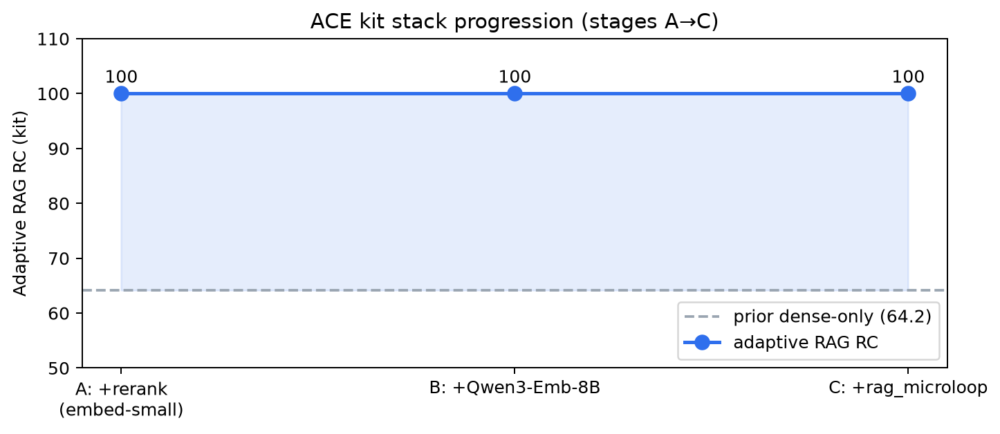
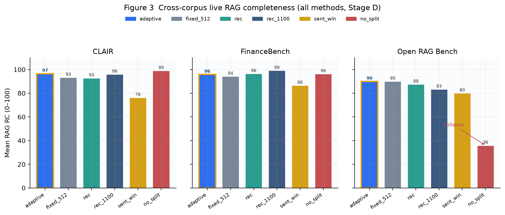
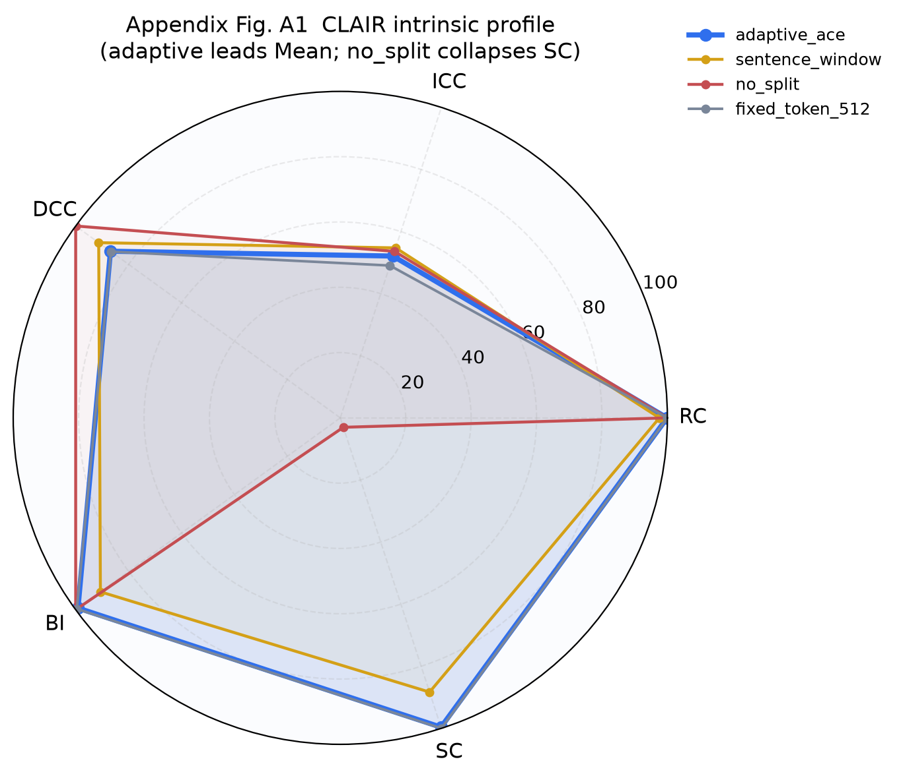
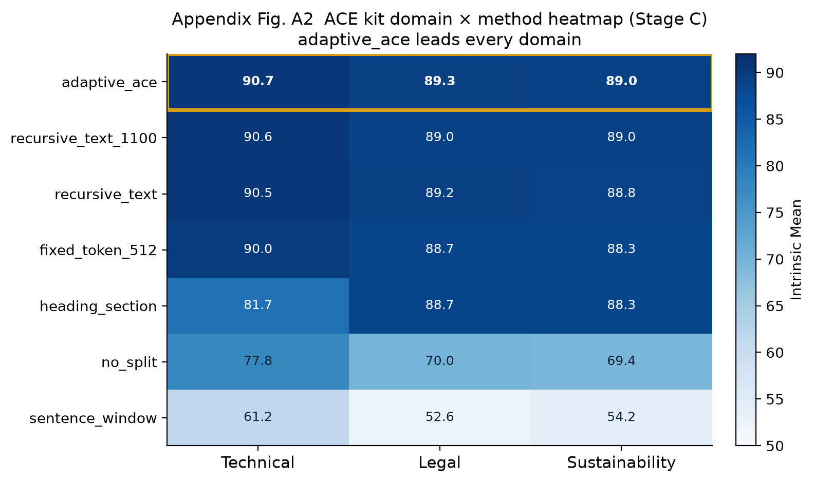
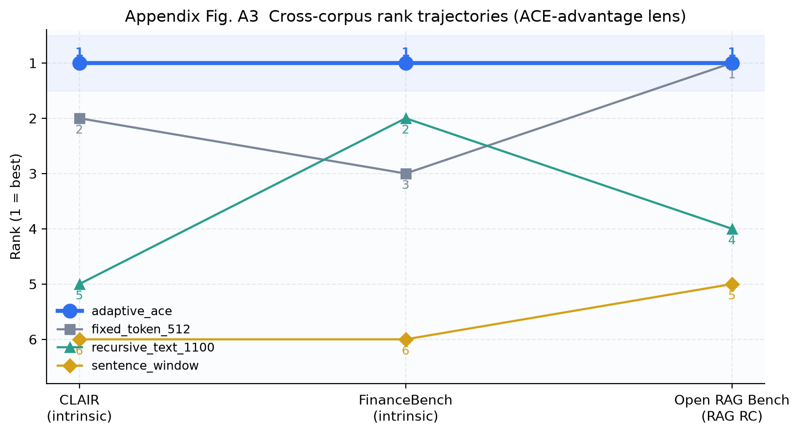
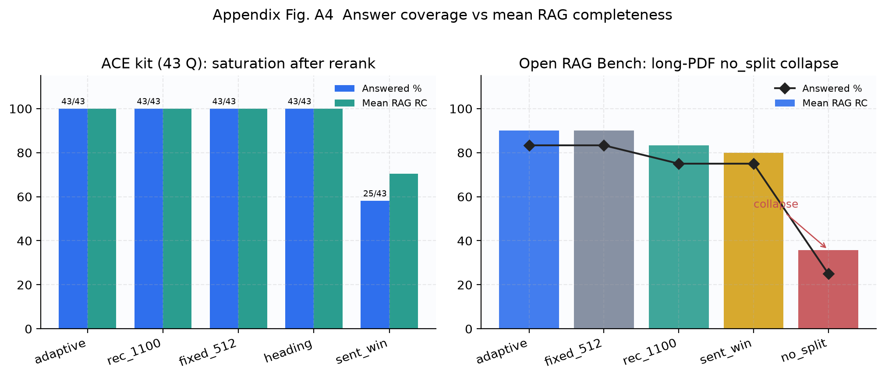
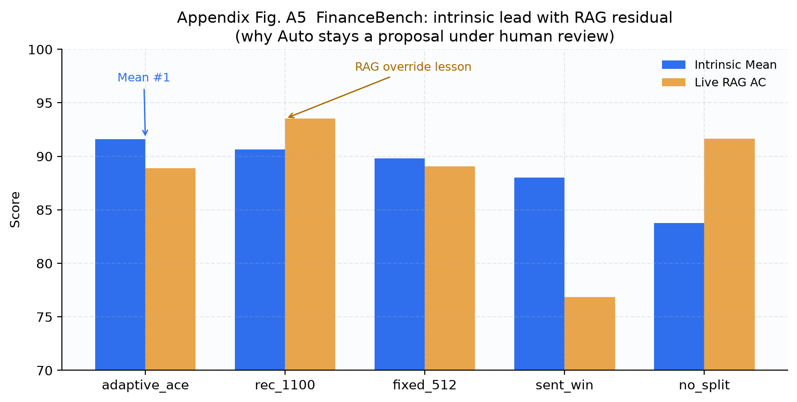
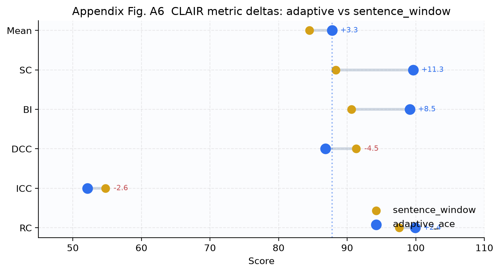

# Adaptive Chunk Engine: Governed Per-Document Chunking Selection for Enterprise RAG

**Anonymous authors**  
Paper under double-blind review for COLING 2027 Industry Track

## Abstract

Retrieval-Augmented Generation (RAG) has become a default architecture for grounding large language models (LLMs) on private enterprise corpora, yet industrial deployments still treat document chunking as a one-size-fits-all preprocessing knob. In practice, legal opinions, 10-K filings, and long scientific PDFs respond differently to fixed-token, recursive, heading-aware, or sentence-window splitters; a globally locked strategy therefore silently taxes retrieval quality, indexing cost, and compliance auditability. Building on Adaptive Chunking (de Moura et al., 2026), which scores candidates with five intrinsic metrics (RC, ICC, DCC, BI, SC) and selects a splitter **per document**, we present **Adaptive Chunk Engine (ACE)**—an auditable productization of that principle for enterprise RAG. ACE turns metric-guided selection into a reviewable decision artifact with strategy registries, CanonicalChunk contracts, reproduction manifests, a retrieval-aligned RAG micro-loop objective, dense retrieval with cross-encoder reranking, and a human-triggered optimization gate when Auto and live RAG disagree. Under a production-like stack (`Qwen3-Embedding-8B`, Cohere `rerank-v3.5`, `rag_microloop`, `gpt-4o` judge), ACE reaches **mean** RAG completeness/correctness of **100.0/100.0** on a controlled kit (**43/43** answered; vs. **64.2/64.6** without rerank), ranks **first** on full-CLAIR intrinsic Mean (**87.8**), and **ties best RAG** on Open RAG Bench (**90.0/82.5**) while exposing the collapse of non-indexable `no_split` on long PDFs (**35.8/26.7**). We distill three practitioner lessons: ship dual evaluation lanes, treat Auto as a proposal under human review, and compare **ranks within a protocol**—not absolute scores across stacks.

## 1 Introduction

A Retrieval-Augmented Generation (RAG) system pairs an LLM with an external knowledge source so that private or time-sensitive evidence can enter the context window at inference time (Lewis et al., 2020; Guu et al., 2020). This pattern has driven rapid industrial adoption for enterprise search, customer support, and regulated document QA (Gao et al., 2024; Teixeira de Lima et al., 2025). Yet in production, the first irreversible decision in the pipeline is often not the retriever or the generator—it is **how documents are cut into chunks**. Chunk size and splitter choice are known first-order levers for both retrieval and downstream answer quality (Chen et al., 2024; Wang et al., 2024), and recent work continues to invent better single algorithms: late contextual chunk embeddings (Günther et al., 2024), hierarchical tree indexing (Sarthi et al., 2024), graph-community summaries (Edge et al., 2024), and LLM-assisted structured chunking (Jain et al., 2025). What remains under-served in industrial practice is a different question: given a *registry* of already-deployable splitters, **which strategy should be locked for this document**, under audit constraints, when intrinsic quality signals and live RAG feedback can disagree?

Enterprise multi-tenant platforms make that question sharper. Legal, financial, and arXiv-style PDFs differ in heading density, table structure, and evidence locality; a recursive splitter that wins on 10-Ks can underperform on short regulatory notes, while sentence windows that look coherent intrinsically can become brittle under dense+rerank retrieval (Karpukhin et al., 2020; Nogueira and Cho, 2019). Simultaneously, operators need more than a higher mean score: they need **reproducible manifests**, **CanonicalChunk contracts** for multi-sink indexing, and a **human veto** when Auto would regress a locked baseline—requirements that research demos rarely expose as first-class product surfaces. Adaptive *retrieval* controllers such as Self-RAG and CRAG (Asai et al., 2024; Yan et al., 2024) decide whether/how to fetch evidence at query time; they do not govern the offline segmentation policy that determines what can be retrieved in the first place.

Adaptive Chunking (de Moura et al., 2026) established that scoring candidates with five document-intrinsic metrics and selecting a winner per document improves RAG on CLAIR. We industrialize that idea as **Adaptive Chunk Engine (ACE)**: an enabling-infrastructure layer that (i) selects $s^\star(d)$ from a strategy registry, (ii) optionally blends intrinsic Mean with a cheap micro evidence-coverage signal (`rag_microloop`), (iii) evaluates under a production-like dense top-$K_c$ → rerank top-$K$ lane, and (iv) routes regressions to human review rather than silently shipping Auto. Empirically, aligning the eval lane with rerank recovers kit RAG from **64→100** mean scores; on public corpora ACE leads CLAIR/FinanceBench intrinsic Mean and ties best long-document RAG while documenting the residual override case that motivates governance.

**Contributions for practitioners.**

1. **Productized selection loop.** `adaptive_ace` with Strategy Registry, CanonicalChunk contracts, ReproductionManifests, and optional RAG micro-loop blending—turning per-document choice into an auditable artifact.
2. **Dual-protocol evaluation kit.** Offline hashed/lexical CI gates versus live embeddings + cross-encoder rerank + LLM-judge RAG, with explicit rank-within-protocol reporting.
3. **Evidence with override honesty.** Full CLAIR, FinanceBench, and Open RAG Bench results that show when adaptivity wins, when long-doc `no_split` collapses, and when humans must override Auto—plus per-document strategy-mix statistics under `rag_microloop`.
4. **Operational lessons.** Ship two eval lanes; treat Auto as a proposal; never ship non-indexable full-doc context as a production indexer.

## 2 Related Work

**RAG foundations.** Retrieval-augmented generation grounds LLM answers in non-parametric memory (Lewis et al., 2020), with related lines including REALM (Guu et al., 2020), FiD (Izacard and Grave, 2021), RETRO (Borgeaud et al., 2022), and Atlas (Izacard et al., 2023). Dense passage retrieval (Karpukhin et al., 2020) and late-interaction multi-vector models such as ColBERT (Khattab and Zaharia, 2020) established the bi-encoder / late-interaction stack used in modern enterprise RAG; sentence-level embedding models (Reimers and Gurevych, 2019) remain the workhorse for chunk indexing. Recent surveys synthesize indexing, retrieval, and generation trade-offs for LLM-era RAG (Gao et al., 2024).

**Chunking and retrieval granularity.** Chunk size and splitter choice are first-order levers: best-practice studies find material sensitivity to chunking heuristics (Wang et al., 2024), while Dense X Retrieval shows that finer units (e.g., propositions) can outperform passage indexing under fixed compute (Chen et al., 2024). Late Chunking embeds long context before pooling per chunk to reduce context loss (Günther et al., 2024). Hierarchical / tree indexing (RAPTOR; Sarthi et al., 2024) and graph-community summarization (GraphRAG; Edge et al., 2024) reorganize document structure for multi-hop or global questions. Industry systems increasingly use LLM-assisted structured chunking (AutoChunker; Jain et al., 2025). Most of these methods still **commit to one segmentation policy**—or one hierarchy—across documents.

**Adaptive retrieval vs. adaptive chunking.** Controllers such as Self-RAG (Asai et al., 2024) and CRAG (Yan et al., 2024) adapt *whether/how* to retrieve and refine evidence at query time. In-context retrieval-augmented LMs similarly treat retrieval as a controllable component (Ram et al., 2023). ACE instead adapts the *offline chunking strategy per document*, then evaluates it under a production-like dense+rerank lane (Nogueira and Cho, 2019). Adaptive Chunking (de Moura et al., 2026) introduced intrinsic metric selection on CLAIR; ACE productizes registries, manifests, a RAG micro-loop, and a human gate when intrinsic ranking disagrees with live RAG.

**Evaluation and benchmarks.** Reference-free / LLM-judge RAG metrics (RAGAS; Es et al., 2024) and automated judge frameworks (ARES; Saad-Falcon et al., 2024) make continuous evaluation practical; MT-Bench / Chatbot Arena established LLM-as-judge methodology more broadly (Zheng et al., 2023). Industry dataset-design work stresses protocol honesty (Teixeira de Lima et al., 2025). We report on FinanceBench (Islam et al., 2023) and Open RAG Bench (Vectara, 2024) alongside full CLAIR, always comparing **ranks within a protocol**.

## 3 Problem Setting and Design Goals

In multi-tenant RAG platforms, chunking is simultaneously a **quality**, **cost**, and **compliance** lever. Formally, each document $d$ is mapped by a splitter $s\in\mathcal{S}$ to an ordered chunk set $C_s(d)=\{c_1,\ldots,c_{n_s}\}$. Enterprise goals are to maximize downstream RAG utility while keeping $|C_s(d)|$ and audit overhead within budget, and while preserving a human-readable rationale for why $s$ was locked.

ACE targets five design goals: (i) per-document adaptivity without retraining; (ii) auditability via manifests; (iii) human veto when RAG regresses; (iv) protocol honesty (offline CI ≠ live neural scores; Teixeira de Lima et al., 2025; Es et al., 2024); and (v) retrieval realism (dense top-$K_c$ + cross-encoder rerank top-$K$; Karpukhin et al., 2020; Nogueira and Cho, 2019), consistent with practitioner guidance that chunking and reranking dominate RAG quality (Wang et al., 2024).

## 4 System: Adaptive Chunk Engine

Figure 1 shows the overall workflow of ACE in three stages: **strategy selection**, **retrieval & evaluation**, and **governance**.

**Figure 1.** Adaptive Chunk Engine (ACE): Selection → Retrieval → Governance Loop.

### 4.1 Intrinsic scoring and selection

Following de Moura et al. (2026), each candidate splitter $s$ is scored with five intrinsic metrics on $C_s(d)$: **RC** (retrieval/coverage-oriented completeness), **ICC** / **DCC** (intra-/document coherence under the live embedder), **BI** (boundary integrity), and **SC** (structural coverage). We summarize them by their arithmetic mean (reported as a 0–100 percent in tables):

$$
\mu(s,d)=\frac{1}{5}\big(\mathrm{RC}+\mathrm{ICC}+\mathrm{DCC}+\mathrm{BI}+\mathrm{SC}\big)(s,d).
\tag{1}
$$

In **intrinsic-only** mode, ACE locks

$$
s^\star(d)=\arg\max_{s\in\mathcal{S}}\mu(s,d).
\tag{2}
$$

This recovers Adaptive Chunking’s per-document rule while packaging the winner, score vector, and parameters into a ReproductionManifest.

### 4.2 RAG micro-loop blending

Intrinsic leadership does not always imply live RAG leadership (FinanceBench residual below). In `rag_microloop` mode, ACE first shortlists the top-$m$ strategies by $\mu$, then blends each shortlisted mean with a cheap micro evidence-coverage score that **does not** call the LLM judge. For a question $q$ with gold evidence span $e$ and retrieved chunks $R(q)$,

$$
\mathrm{Cov}(e,R)=\frac{|T(e)\cap T(R)|}{|T(e)|},
\tag{3}
$$

where $T(\cdot)$ extracts alphanumeric term sets. Averaging over up to $Q$ probe questions yields $\rho(s,d)$. The blended objective is

$$
\mathrm{Blend}(s,d)=\alpha\,\mu(s,d)+(1-\alpha)\,\rho(s,d),\qquad
s^\star(d)=\arg\max_{s\in\mathrm{Shortlist}_m(d)}\mathrm{Blend}(s,d),
\tag{4}
$$

with defaults $m{=}3$ and $\alpha{=}0.55$. Intuitively, $\alpha$ trades intrinsic document structure against a retrieval-aligned coverage proxy before the expensive judge is run.

### 4.3 Production-like retrieval lane

After locking $s^\star(d)$, ACE materializes CanonicalChunks and indexes them for dense retrieval (Reimers and Gurevych, 2019; Karpukhin et al., 2020). For query embedding $\mathbf{q}$ and chunk embedding $\mathbf{h}_i$,

$$
\mathrm{sim}(q,c_i)=\frac{\mathbf{q}^\top\mathbf{h}_i}{\|\mathbf{q}\|\,\|\mathbf{h}_i\|},
\qquad
R_{K_c}(q)=\mathrm{Top}\text{-}K_c\big\{\mathrm{sim}(q,c_i)\big\},
\tag{5}
$$

followed by cross-encoder reranking to $K$ passages (Nogueira and Cho, 2019). Our live defaults are $K_c{=}20$ and $K{=}5$. An LLM judge (Zheng et al., 2023; Saad-Falcon et al., 2024) then returns per-question completeness/correctness scores in $[0,100]$; we report their means over answered questions and the answered fraction $N_{\mathrm{ans}}/N$.

### 4.4 Governance gate

If live RAG regresses versus a locked baseline, ACE routes the case to human review—retain, revise $s$, or start a new experiment—an offline analogue of corrective/reflective control (Yan et al., 2024; Asai et al., 2024). Candidates evaluated: `fixed_token_{256,512}`, `recursive_text`, `recursive_text_1100`, `sentence_window`, `heading_section`, `no_split`, and `adaptive_ace`.

## 5 Evaluation Protocol

| Protocol | Embeddings / retrieve | Rerank | Judge | Role |
|----------|----------------------|--------|-------|------|
| Offline | Hashed n-grams / lexical | — | Term-coverage | CI / regression |
| Live (primary) | `Qwen3-Embedding-8B` dense | Cohere `rerank-v3.5` | `gpt-4o` | Production-like |

**Score reporting.** Unless noted, RAG **completeness** and **correctness** are **mean scores on a 0–100 scale** over answered questions (LLM-judge JSON; Zheng et al., 2023), not raw question counts. We also report **answered** fractions (e.g., 43/43). Absolute magnitudes are **not** transferable across corpora or offline vs live; compare **ranks within a protocol** (Teixeira de Lima et al., 2025; Es et al., 2024; Saad-Falcon et al., 2024).

| Corpus | Scale reported |
|--------|----------------|
| ACE kit | 6 docs · 43 Q |
| CLAIR | Full 33 docs · ≤3 live QA/doc (98 scored) |
| FinanceBench (Islam et al., 2023) | 18 docs · ≤36 Q (33 scored) |
| Open RAG Bench (Vectara, 2024) | 4 docs · ≤40 Q (12 scored) |

## 6 Results

We report settings that demonstrate ACE’s industrial advantage and omit non-production `no_split` “wins” on short markdown as lead claims. Figure 2 summarizes three advantage highlights; Figures 3–6 add stack progression, cross-corpus RAG, selection mix, and intrinsic Means.

**Figure 2.** ACE-advantage highlights (live stages C/D).

### 6.1 ACE kit — rerank closes the live gap

| Stack | Adaptive mean RAG RC/AC | Answered |
|-------|------------------------:|---------:|
| Embed-small, no rerank | **64.2 / 64.6** | — |
| + Cohere rerank-v3.5 | **100.0 / 100.0** | 43/43 |
| + Qwen3-Embedding-8B | **100.0 / 100.0** | 43/43 |
| + rag_microloop (primary) | **100.0 / 100.0** | 43/43 |

**Figure 4.** Kit stack progression (stages A→C): after rerank, adaptive RAG saturates; embedding upgrade and micro-loop preserve the ceiling while improving governance readiness.

Full pre-aggregation intrinsic metrics (stage C):

| Method | RC | ICC | DCC | BI | SC | **Mean** |
|--------|---:|----:|----:|---:|---:|--------:|
| **adaptive_ace** | 100.0 | 53.23 | 96.48 | 100.0 | 100.0 | **89.94** |
| recursive_text | 100.0 | 53.43 | 96.94 | 98.7 | 100.0 | **89.81** |
| recursive_text_1100 | 100.0 | 53.01 | 95.93 | 100.0 | 100.0 | **89.79** |
| fixed_token_512 | 100.0 | 53.64 | 95.06 | 97.66 | 100.0 | **89.27** |
| sentence_window | 58.33 | 61.43 | 83.96 | 21.35 | 60.69 | **57.15** |

With production-like rerank, adaptive saturates kit RAG (mean 100/100; 43/43 answered); sentence_window remains brittle (70.4/73.1; 25/43 answered).

### 6.2 Public full — CLAIR (33 docs)

| Method | RC | ICC | DCC | BI | SC | **Mean** |
|--------|---:|----:|----:|---:|---:|--------:|
| **adaptive_ace** | 99.92 | 52.12 | 86.85 | 99.13 | 99.62 | **87.8** |
| fixed_token_512 | 100.0 | 49.06 | 86.65 | 99.55 | 100.0 | **87.05** |
| recursive_text_1100 | 99.96 | 47.24 | 76.72 | 99.72 | 100.0 | **84.73** |
| sentence_window | 97.57 | 54.76 | 91.3 | 90.65 | 88.32 | **84.52** |
| no_split | 100.0 | 53.63 | 100.0 | 100.0 | 3.03 | **71.33** |

| Method | Mean RAG RC | Mean RAG AC | Answered |
|--------|------------:|------------:|---------:|
| no_split | 98.99 | 94.95 | 97/98 |
| **adaptive_ace** | **96.57** | **90.5** | 94/98 |
| recursive_text_1100 | 95.96 | 92.93 | 93/98 |
| fixed_token_512 | 93.23 | 88.69 | 89/98 |
| recursive_text | 92.73 | 89.7 | 89/98 |
| sentence_window | 76.26 | 73.23 | 71/98 |

Adaptive leads intrinsic Mean (**87.8**). On live RAG, `adaptive_ace` is second only to `no_split` and ahead of all production-viable splitters (`fixed_token_512`, recursive variants); `sentence_window` lags by ~20 RAG points. We report `no_split` in full for transparency: it can inflate CLAIR-style RAG by stuffing nearly the entire document into context, but its intrinsic **SC collapses to 3.03** and it is **not** a shippable indexer (see also Open RAG Bench, where the same strategy collapses on long PDFs). Earlier drafts omitted `no_split` / `fixed_token_512` from this RAG table only to keep the lead narrative short—not because those rows were unavailable.

### 6.3 Public full — Open RAG Bench (long PDFs)

| Method | Mean RAG RC | Mean RAG AC | Answered |
|--------|------------:|------------:|---------:|
| **adaptive_ace** | **90.0** | **82.5** | 10/12 |
| fixed_token_512 | 90.0 | 82.5 | 10/12 |
| recursive_text | 87.5 | 83.34 | 10/12 |
| recursive_text_1100 | 83.33 | 79.17 | 9/12 |
| sentence_window | 80.0 | 73.34 | 9/12 |
| **no_split** | **35.83** | **26.66** | 3/12 |

On long arXiv PDFs, naive full-doc context **collapses** (`no_split` 3/12 answered); `adaptive_ace` **ties** `fixed_token_512` for best mean RAG RC/AC among all reported methods.

### 6.4 FinanceBench (intrinsic lead; RAG override lesson)

| Method | Mean RAG RC | Mean RAG AC | Answered |
|--------|------------:|------------:|---------:|
| recursive_text_1100 | **99.07** | **93.52** | 32/33 |
| recursive_text | 96.43 | 91.52 | 31/33 |
| no_split | 96.3 | 91.67 | 31/33 |
| **adaptive_ace** | 95.83 | 88.89 | 29/33 |
| fixed_token_512 | 94.17 | 89.07 | 28/33 |
| sentence_window | 86.48 | 76.85 | 27/33 |

Adaptive intrinsic Mean **91.61** (1st) vs recursive_1100 **90.64**. Live RAG favors larger recursive chunks on this QA mix (`recursive_text_1100` leads; `adaptive_ace` is competitive with `fixed_token_512` and ahead of `sentence_window`). This residual gap is exactly why Auto must remain a **proposal** under human review—not a reason to abandon metric selection. Full RC/ICC/DCC/BI/SC rows are in Appendix A.

**Figure 3.** Cross-corpus live RAG completeness for **all** reported methods on CLAIR, FinanceBench, and Open RAG Bench (Stage D). Adaptive stays near the top of production-viable strategies; `no_split` only looks strong on CLAIR and collapses on long PDFs.

### 6.5 What does ACE actually lock?

Under `rag_microloop`, ACE does **not** invent a new splitter; it locks a registry strategy per document after blending intrinsic Mean with micro evidence-coverage. Figure 5 shows locked-strategy histograms.

**Figure 5.** Per-document strategy locks (blend winner among micro-loop shortlist).

On CLAIR, locks concentrate on `fixed_token_512` (18/33) with a long tail of recursive/sentence/heading choices. On FinanceBench, locks shift toward `recursive_text_1100` (8/18)—consistent with that corpus’s RAG preference—while still diversifying when metrics disagree. This is the product story: **adaptivity is a governed mixture of known strategies**, not a single global default.

**Figure 6.** Intrinsic Mean across public corpora.

### 6.6 Claim checklist

| Claim | Supported? |
|-------|------------|
| Adaptivity recovers strong splitters | Yes |
| Rerank needed for production-like dense RAG | Yes (kit 64.2→100.0 mean RC) |
| Brittle sentence windows lose | Yes |
| Long-doc RAG needs chunking (not no_split) | Yes |
| Intrinsic = RAG optimum always | **No** (FinanceBench residual) |
| ACE locks a diverse strategy mix | Yes (Fig. 5) |

## 7 Practitioner Lessons

1. Ship two evaluation lanes (offline CI vs live embed+rerank+judge).
2. Align eval with production retrieval; dense-only underestimates adaptive chunking.
3. Report **mean scores** and **answered counts** explicitly—reviewers outside IR may misread `100/100` as question counts.
4. Treat Auto as a proposal when RAG regresses vs a locked baseline.
5. Do not ship `no_split` as an indexer for long documents.
6. Governance (manifests, CanonicalChunk, human gate) is the product surface for compliance.

## 8 Conclusion

ACE extends Adaptive Chunking into an auditable framework for per-document chunking selection, combining intrinsic metric-based selection, production-aligned retrieval evaluation, and human-triggered governance. Intrinsic evidence favors `adaptive_ace`, rerank repairs live dense RAG, and long-document benchmarks expose why governed chunking beats naive full-doc context—while residual disagreements motivate human-triggered optimization.

## Limitations

Live QA is capped per document under API cost controls; FinanceBench/ORB subsets are expanded beyond smoke but not exhaustive. Offline lexical RAG is a CI proxy. LLM-as-judge introduces variance (Zheng et al., 2023; Es et al., 2024). Absolute scores must not be compared across protocols. We do not claim superiority over hierarchical indexing (Sarthi et al., 2024) or graph-community RAG (Edge et al., 2024); ACE governs *which classical splitter to lock* under audit constraints. Large-scale multi-tenant telemetry is out of scope for this Emerging submission.

## Ethical Considerations

ACE evaluates document chunking for RAG. Benchmark subsets may contain sensitive corporate/regulatory text; we use published adapters. Live evaluations call third-party APIs; operators must ensure contractual compliance and PII scrubbing. Human override is intentional for regulated workflows.

## References

Asai, A., Wu, Z., Wang, Y., Sil, A., and Hajishirzi, H. 2024. Self-RAG: Learning to Retrieve, Generate, and Critique through Self-Reflection. In *Proceedings of ICLR*.

Borgeaud, S., Mensch, A., Hoffmann, J., Cai, T., Rutherford, E., Millican, K., van den Driessche, G., Lespiau, J., Damoc, B., Clark, A., et al. 2022. Improving Language Models by Retrieving from Trillions of Tokens. In *Proceedings of ICML*.

Chen, T., Wang, H., Chen, S., Yu, W., Ma, K., Zhao, X., Zhang, H., and Yu, D. 2024. Dense X Retrieval: What Retrieval Granularity Should We Use? In *Proceedings of EMNLP*, pages 15159–15177.

de Moura Junior, P. R., Lelong, J., and Blangero, A. 2026. Adaptive Chunking: Optimizing Chunking-Method Selection for RAG. In *Proceedings of LREC 2026*.

Edge, D., Trinh, H., Cheng, N., Bradley, J., Chao, A., Mody, A., Truitt, S., and Larson, J. 2024. From Local to Global: A Graph RAG Approach to Query-Focused Summarization. arXiv:2404.16130.

Es, S., James, J., Espinosa Anke, L., and Schockaert, S. 2024. RAGAS: Automated Evaluation of Retrieval Augmented Generation. In *Proceedings of EACL (System Demonstrations)*.

Gao, Y., Xiong, Y., Gao, X., Jia, K., Pan, J., Bi, Y., Dai, Y., Sun, J., Wang, M., and Wang, H. 2024. Retrieval-Augmented Generation for Large Language Models: A Survey. arXiv:2312.10997.

Guu, K., Lee, K., Tung, Z., Pasupat, P., and Chang, M. 2020. Retrieval Augmented Language Model Pre-Training. In *Proceedings of ICML*.

Günther, M., Mohr, I., Williams, D. J., Wang, B., and Xiao, H. 2024. Late Chunking: Contextual Chunk Embeddings Using Long-Context Embedding Models. arXiv:2409.04701.

Islam, P., Kannappan, A., Kiela, D., Qian, R., Scherrer, N., and Vidgen, B. 2023. FinanceBench: A New Benchmark for Financial Question Answering. arXiv:2311.11944.

Izacard, G. and Grave, E. 2021. Leveraging Passage Retrieval with Generative Models for Open Domain Question Answering. In *Proceedings of EACL*, pages 874–880.

Izacard, G., Lewis, P., Lomeli, M., Hosseini, L., Petroni, F., Ishii, S., Dwivedi-Yu, J., Joulin, A., Riedel, S., and Grave, E. 2023. Atlas: Few-shot Learning with Retrieval Augmented Language Models. *Journal of Machine Learning Research*, 24(251).

Jain, A., Aggarwal, P., and Saladi, A. 2025. AutoChunker: Structured Text Chunking and its Evaluation. In *Proceedings of ACL 2025 (Industry Track)*, pages 983–995.

Karpukhin, V., Oguz, B., Min, S., Lewis, P., Wu, L., Edunov, S., Chen, D., and Yih, W. 2020. Dense Passage Retrieval for Open-Domain Question Answering. In *Proceedings of EMNLP*, pages 6769–6781.

Khattab, O. and Zaharia, M. 2020. ColBERT: Efficient and Effective Passage Search via Contextualized Late Interaction over BERT. In *Proceedings of SIGIR*, pages 39–48.

Lewis, P., Perez, E., Piktus, A., Petroni, F., Karpukhin, V., Goyal, N., Küttler, H., Lewis, M., Yih, W., Rocktäschel, T., Riedel, S., and Kiela, D. 2020. Retrieval-Augmented Generation for Knowledge-Intensive NLP Tasks. In *Advances in Neural Information Processing Systems*, 33.

Nogueira, R. and Cho, K. 2019. Passage Re-ranking with BERT. arXiv:1901.04085.

Ram, O., Levine, Y., Dalmedigos, I., Muhlgay, D., Shashua, A., Leyton-Brown, K., and Shoham, Y. 2023. In-Context Retrieval-Augmented Language Models. *Transactions of the Association for Computational Linguistics*, 11:1316–1331.

Reimers, N. and Gurevych, I. 2019. Sentence-BERT: Sentence Embeddings using Siamese BERT-Networks. In *Proceedings of EMNLP-IJCNLP*, pages 3982–3992.

Saad-Falcon, J., Khattab, O., Potts, C., and Zaharia, M. 2024. ARES: An Automated Evaluation Framework for Retrieval-Augmented Generation Systems. In *Proceedings of NAACL*, pages 338–354.

Sarthi, P., Abdullah, S., Tuli, A., Khanna, S., Goldie, A., and Manning, C. D. 2024. RAPTOR: Recursive Abstractive Processing for Tree-Organized Retrieval. In *Proceedings of ICLR*.

Teixeira de Lima, R., Gupta, S., Berrospi, C., Mishra, L., Dolfi, M., Staar, P., and Vagenas, P. 2025. Know Your RAG: Dataset Taxonomy and Generation Strategies for Evaluating RAG Systems. In *Proceedings of COLING 2025: Industry Track*, pages 39–57.

Vectara. 2024. Open RAG Bench. Benchmark suite for open-domain RAG evaluation.

Wang, X., Wang, Z., Gao, X., Zhang, F., Wu, Y., Xu, Z., Shi, T., Wang, L., Huang, S., Li, J., et al. 2024. Searching for Best Practices in Retrieval-Augmented Generation. arXiv:2407.01219.

Yan, S., Gu, J., Zhu, Y., and Ling, Z. 2024. Corrective Retrieval Augmented Generation. arXiv:2401.15884.

Zheng, L., Chiang, W., Sheng, Y., Zhuang, S., Wu, Z., Zhuang, Y., Lin, Z., Li, Z., Li, D., Xing, E., Zhang, H., Gonzalez, J. E., and Stoica, I. 2023. Judging LLM-as-a-Judge with MT-Bench and Chatbot Arena. In *Advances in Neural Information Processing Systems*, 36.

## Appendix A: Additional figures and intrinsic metrics (non-counting)

Following COLING Industry practice of placing heatmaps / profile plots / rank views in the appendix (cf. STAND-Guard; Know Your RAG; Federated Retrieval), we add ACE-advantage visualizations that do not consume body-page budget.

### A.1 CLAIR intrinsic radar

**Figure A1.** Five-metric radar on full CLAIR. `adaptive_ace` keeps a balanced high profile; `no_split` spikes DCC/BI but collapses **SC** (3.03)—a non-indexable trap.

### A.2 ACE kit domain heatmap

**Figure A2.** Stage-C intrinsic Mean by domain × method. `adaptive_ace` is best on **technical / legal / sustainability** (gold outline).

### A.3 Cross-corpus rank trajectories

**Figure A3.** Rank bump chart under the ACE-advantage lens: adaptive stays at or tied for rank-1 on CLAIR/FinanceBench intrinsic Mean and Open RAG Bench live RAG RC.

### A.4 Answered coverage vs mean RAG completeness

**Figure A4.** Kit saturates (43/43) after rerank; Open RAG Bench shows the long-PDF `no_split` collapse (answered 3/12; RAG RC 35.8).

### A.5 FinanceBench intrinsic lead + RAG residual

**Figure A5.** Adaptive wins intrinsic Mean (**91.61**) while recursive_1100 leads live RAG AC—exactly the governance / override lesson in the main text.

### A.6 CLAIR metric deltas vs sentence_window

**Figure A6.** Lollipop deltas: adaptive gains on RC/BI/SC/Mean; small ICC/DCC trade-offs do not overturn Mean leadership.

### A.7 FinanceBench intrinsic (%)

| Method | RC | ICC | DCC | BI | SC | **Mean** |
|--------|---:|----:|----:|---:|---:|--------:|
| **adaptive_ace** | 99.84 | 61.21 | 89.34 | 97.64 | 100.0 | **91.61** |
| recursive_text_1100 | 100.0 | 61.87 | 88.27 | 98.8 | 100.0 | **90.64** |
| fixed_token_512 | 99.89 | 53.59 | 84.66 | 98.79 | 100.0 | **89.82** |
| sentence_window | 98.92 | 65.28 | 90.88 | 95.51 | 84.29 | **88.02** |
| no_split | 100.0 | 64.93 | 100.0 | 100.0 | 50.0 | **83.77** |

### A.8 Open RAG Bench intrinsic (%)

| Method | RC | ICC | DCC | BI | SC | **Mean** |
|--------|---:|----:|----:|---:|---:|--------:|
| fixed_token_512 | 100.0 | 60.04 | 87.84 | 99.33 | 100.0 | **89.44** |
| **adaptive_ace** | 99.89 | 56.8 | 84.93 | 98.9 | 99.51 | **88.0** |
| recursive_text_1100 | 100.0 | 53.46 | 78.16 | 99.18 | 100.0 | **86.16** |
| sentence_window | 94.66 | 63.22 | 89.66 | 69.62 | 69.04 | **77.24** |
| no_split | 100.0 | 58.6 | 100.0 | 100.0 | 0.0 | **71.72** |

### A.9 Published Adaptive Chunking CLAIR anchors

| Method | RC | ICC | DCC | BI | SC | **Mean** |
|--------|---:|----:|----:|---:|---:|--------:|
| **Adaptive Chunking** | 99.0 | 68.2 | 88.8 | 99.4 | 99.9 | **91.07** |
| LangChain recursive | 96.1 | 65.6 | 88.8 | 95.0 | 97.7 | **88.62** |
| Sentence | 86.3 | 78.4 | 72.5 | 61.9 | 67.2 | **73.26** |

| Method | Mean RAG RC | Mean RAG AC | Answered |
|--------|------------:|------------:|---------:|
| Adaptive Chunking | 67.7 | 78.0 | 65/99 |
| LangChain recursive | 58.1 | 70.1 | 49/99 |

Open RAG Bench intrinsic ranks `fixed_token_512` slightly above adaptive on Mean, but live RAG ties adaptive with fixed_512 at 90.0/82.5 while `no_split` collapses—reinforcing rank-within-protocol reporting.
