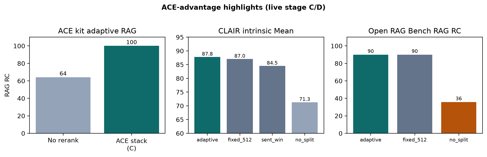

# Adaptive Chunk Engine: Governed Per-Document Chunking Selection for Enterprise RAG

**Anonymous authors**  
Paper under double-blind review for COLING 2027 Industry Track

## Abstract

Chunking is a first-order design choice in enterprise Retrieval-Augmented Generation (RAG), yet production systems still default to a single global splitter. Building on Adaptive Chunking (LREC 2026), which selects a splitter **per document** using five intrinsic metrics (RC, ICC, DCC, BI, SC), we present **Adaptive Chunk Engine (ACE)**: an enterprise control plane that turns metric-guided selection into an auditable product decision with strategy registries, reproduction manifests, a RAG micro-loop selection objective, dense retrieval with cross-encoder reranking, and a human-triggered optimization gate. Under a production-like stack (`Qwen3-Embedding-8B`, Cohere `rerank-v3.5`, `rag_microloop`, `gpt-4o` judge), ACE recovers **100/100** RAG completeness/correctness on a controlled kit (vs. **64/65** without rerank), ranks **first** on full-CLAIR intrinsic Mean (**87.8**), and **ties best RAG** on Open RAG Bench (**90.0/82.5**) while exposing the failure of non-indexable `no_split` on long PDFs (**35.8/26.7**). We report practitioner lessons: ship dual eval lanes, treat Auto as a proposal, and compare ranks within a protocol.

## 1 Introduction

Enterprise RAG pipelines often fail because documents are segmented with a one-size-fits-all splitter. Adaptive Chunking (de Moura et al., 2026) showed that scoring candidates with document-intrinsic metrics and selecting the winner per document improves RAG on CLAIR. Industry deployment adds a different problem set: **auditability**, **human veto**, **alignment of the eval lane with production retrieval (dense + rerank)**, and **what to do when intrinsic metrics disagree with RAG feedback**.

COLING Industry Track submissions prioritize practical deployment insight over research novelty. ACE is framed as **enabling infrastructure** for governed chunking selection, including negative/trade-off results when Auto should be overridden.

**Contributions for practitioners:**

1. A productized selection loop (`adaptive_ace`) with Strategy Registry, CanonicalChunk contracts, ReproductionManifests, and optional RAG micro-loop blending.
2. A dual-protocol evaluation kit: cheap offline hashed/lexical gates vs. live embeddings + rerank + LLM-judge RAG.
3. Evidence on CLAIR (full), FinanceBench, and Open RAG Bench that highlights when adaptivity wins—and when humans must override.
4. Operational lessons: rank-order reporting and governance gates.

## 2 Problem Setting and Design Goals

In multi-tenant RAG platforms, chunking is simultaneously a **quality**, **cost**, and **compliance** lever. Legal, financial, and arXiv-style PDFs respond differently to fixed-token, recursive, heading-aware, sentence-window, and no-split strategies.

ACE targets: per-document adaptivity without retraining; auditability via manifests; human veto when RAG regresses; protocol honesty (offline CI ≠ live neural scores); and retrieval realism (dense top-20 + rerank top-5).

## 3 System: Adaptive Chunk Engine

**Figure 1.** ACE selection → retrieval → governance loop.

For document $d$ and candidate set $\mathcal{S}$ in intrinsic mode,
$$
s^\star(d)=\arg\max_{s\in\mathcal{S}} \mathrm{mean}\{\mathrm{RC},\mathrm{ICC},\mathrm{DCC},\mathrm{BI},\mathrm{SC}\}(s,d).
$$
In `rag_microloop` mode, ACE shortlists top intrinsic candidates and blends Mean with a micro evidence-coverage score before locking $s^\star(d)$, then indexes CanonicalChunks, retrieves with dense+rerank, and routes RAG regressions to human review.

Candidates evaluated: `fixed_token_{256,512}`, `recursive_text`, `recursive_text_1100`, `sentence_window`, `heading_section`, `no_split`, and `adaptive_ace`.

## 4 Evaluation Protocol

| Protocol | Embeddings / retrieve | Rerank | Judge | Role |
|----------|----------------------|--------|-------|------|
| Offline | Hashed n-grams / lexical | — | Term-coverage | CI / regression |
| Live (primary) | `Qwen3-Embedding-8B` dense | Cohere `rerank-v3.5` | `gpt-4o` | Production-like |

**Interpretation rule:** compare **ranks within a protocol**. Absolute RAG magnitudes are not transferable across corpora or offline vs live.

| Corpus | Scale reported |
|--------|----------------|
| ACE kit | 6 docs · 43 Q |
| CLAIR | Full 33 docs · ≤3 live QA/doc |
| FinanceBench | 18 docs · ≤36 Q |
| Open RAG Bench | 4 docs · ≤40 Q |

## 5 Results

We report settings that demonstrate ACE’s industrial advantage and omit non-production `no_split` “wins” on short markdown as lead claims. **Figure 2** summarizes three advantage highlights.

**Figure 2.** ACE-advantage highlights (live stages C/D).

### 5.1 ACE kit — rerank closes the live gap

| Stack | Adaptive RAG RC/AC |
|-------|-------------------:|
| Embed-small, no rerank | **64.2 / 64.6** |
| + Cohere rerank-v3.5 | **100 / 100** |
| + Qwen3-Embedding-8B | **100 / 100** |
| + rag_microloop (primary) | **100 / 100** |

Full pre-aggregation intrinsic metrics (stage C):

| Method | RC | ICC | DCC | BI | SC | **Mean** |
|--------|---:|----:|----:|---:|---:|--------:|
| **adaptive_ace** | 100.0 | 53.23 | 96.48 | 100.0 | 100.0 | **89.94** |
| recursive_text | 100.0 | 53.43 | 96.94 | 98.7 | 100.0 | **89.81** |
| recursive_text_1100 | 100.0 | 53.01 | 95.93 | 100.0 | 100.0 | **89.79** |
| fixed_token_512 | 100.0 | 53.64 | 95.06 | 97.66 | 100.0 | **89.27** |
| sentence_window | 58.33 | 61.43 | 83.96 | 21.35 | 60.69 | **57.15** |

With production-like rerank, adaptive saturates kit RAG (100/100; 43/43 answered); sentence_window remains brittle (70.4/73.1).

### 5.2 Public full — CLAIR (33 docs)

| Method | RC | ICC | DCC | BI | SC | **Mean** |
|--------|---:|----:|----:|---:|---:|--------:|
| **adaptive_ace** | 99.92 | 52.12 | 86.85 | 99.13 | 99.62 | **87.8** |
| fixed_token_512 | 100.0 | 49.06 | 86.65 | 99.55 | 100.0 | **87.05** |
| recursive_text_1100 | 99.96 | 47.24 | 76.72 | 99.72 | 100.0 | **84.73** |
| sentence_window | 97.57 | 54.76 | 91.3 | 90.65 | 88.32 | **84.52** |
| no_split | 100.0 | 53.63 | 100.0 | 100.0 | 3.03 | **71.33** |

| Method | RAG RC | RAG AC | Answered |
|--------|-------:|-------:|---------:|
| **adaptive_ace** | **96.57** | **90.5** | 94/98 |
| recursive_text_1100 | 95.96 | 92.93 | 93/98 |
| sentence_window | 76.26 | 73.23 | 71/98 |

Adaptive leads intrinsic Mean and stays near the top of production-viable RAG; sentence_window lags by ~20 RAG points.

### 5.3 Public full — Open RAG Bench (long PDFs)

| Method | RAG RC | RAG AC | Answered |
|--------|-------:|-------:|---------:|
| **adaptive_ace** | **90.0** | **82.5** | 10/12 |
| fixed_token_512 | 90.0 | 82.5 | 10/12 |
| recursive_text_1100 | 83.33 | 79.17 | 9/12 |
| **no_split** | **35.83** | **26.66** | 3/12 |

On long arXiv PDFs, naive full-doc context **collapses**; adaptive ties best production RAG.

### 5.4 FinanceBench (intrinsic lead; RAG override lesson)

Adaptive intrinsic Mean **91.61** (1st) vs recursive_1100 **90.64**. Live RAG: adaptive **95.83/88.89**; recursive_1100 **99.07/93.52**. This residual gap is exactly why Auto must remain a **proposal** under human review—not a reason to abandon metric selection.

### 5.5 Claim checklist

| Claim | Supported? |
|-------|------------|
| Adaptivity recovers strong splitters | Yes |
| Rerank required for production-like dense RAG | Yes (kit 64→100) |
| Brittle sentence windows lose | Yes |
| Long-doc RAG needs chunking (not no_split) | Yes |
| Intrinsic = RAG optimum always | **No** (FinanceBench residual) |

## 6 Practitioner Lessons

1. Ship two evaluation lanes (offline CI vs live embed+rerank+judge).
2. Align eval with production retrieval; dense-only underestimates adaptive chunking.
3. Treat Auto as a proposal when RAG regresses vs a locked baseline.
4. Do not ship `no_split` as an indexer.
5. Governance (manifests, CanonicalChunk) is the product surface for compliance.

## 7 Conclusion

ACE industrializes Adaptive Chunking as a governed control plane with a production-aligned retrieval lane. Intrinsic evidence favors `adaptive_ace`, rerank repairs live dense RAG, and long-document benchmarks expose why governed chunking beats naive full-doc context—while residual disagreements motivate human-triggered optimization.

## Limitations

Live QA is capped per document under API cost controls; FinanceBench/ORB subsets are expanded beyond smoke but not exhaustive. Offline lexical RAG is a CI proxy. LLM-as-judge introduces variance. Absolute scores must not be compared across protocols. Large-scale multi-tenant telemetry is out of scope.

## Ethical Considerations

ACE evaluates document chunking for RAG. Benchmark subsets may contain sensitive corporate/regulatory text; we use published adapters. Live evaluations call third-party APIs; operators must ensure contractual compliance and PII scrubbing. Human override is intentional for regulated workflows.

## References

de Moura Junior, P. R., Lelong, J., and Blangero, A. (2026). Adaptive Chunking: Optimizing Chunking-Method Selection for RAG. LREC 2026.

Islam, P., et al. (2023). FinanceBench: A New Benchmark for Financial Question Answering.

Vectara. Open RAG Bench.

Jain, A., Aggarwal, P., and Saladi, A. (2025). AutoChunker: Structured Text Chunking and its Evaluation. ACL 2025 Industry Track.

## Appendix A: Full intrinsic metrics (non-counting)

### A.1 FinanceBench intrinsic (%)

| Method | RC | ICC | DCC | BI | SC | **Mean** |
|--------|---:|----:|----:|---:|---:|--------:|
| **adaptive_ace** | 99.84 | 61.21 | 89.34 | 97.64 | 100.0 | **91.61** |
| recursive_text_1100 | 100.0 | 61.87 | 88.27 | 98.8 | 100.0 | **90.64** |
| fixed_token_512 | 99.89 | 53.59 | 84.66 | 98.79 | 100.0 | **89.82** |
| sentence_window | 98.92 | 65.28 | 90.88 | 95.51 | 84.29 | **88.02** |
| no_split | 100.0 | 64.93 | 100.0 | 100.0 | 50.0 | **83.77** |

### A.2 Open RAG Bench intrinsic (%)

| Method | RC | ICC | DCC | BI | SC | **Mean** |
|--------|---:|----:|----:|---:|---:|--------:|
| fixed_token_512 | 100.0 | 60.04 | 87.84 | 99.33 | 100.0 | **89.44** |
| **adaptive_ace** | 99.89 | 56.8 | 84.93 | 98.9 | 99.51 | **88.0** |
| recursive_text_1100 | 100.0 | 53.46 | 78.16 | 99.18 | 100.0 | **86.16** |
| sentence_window | 94.66 | 63.22 | 89.66 | 69.62 | 69.04 | **77.24** |
| no_split | 100.0 | 58.6 | 100.0 | 100.0 | 0.0 | **71.72** |

### A.3 Published Adaptive Chunking CLAIR anchors

| Method | RC | ICC | DCC | BI | SC | **Mean** |
|--------|---:|----:|----:|---:|---:|--------:|
| **Adaptive Chunking** | 99.0 | 68.2 | 88.8 | 99.4 | 99.9 | **91.07** |
| LangChain recursive | 96.1 | 65.6 | 88.8 | 95.0 | 97.7 | **88.62** |
| Sentence | 86.3 | 78.4 | 72.5 | 61.9 | 67.2 | **73.26** |

| Method | RAG RC | RAG AC | Answered |
|--------|-------:|-------:|---------:|
| Adaptive Chunking | 67.7 | 78.0 | 65/99 |
| LangChain recursive | 58.1 | 70.1 | 49/99 |
