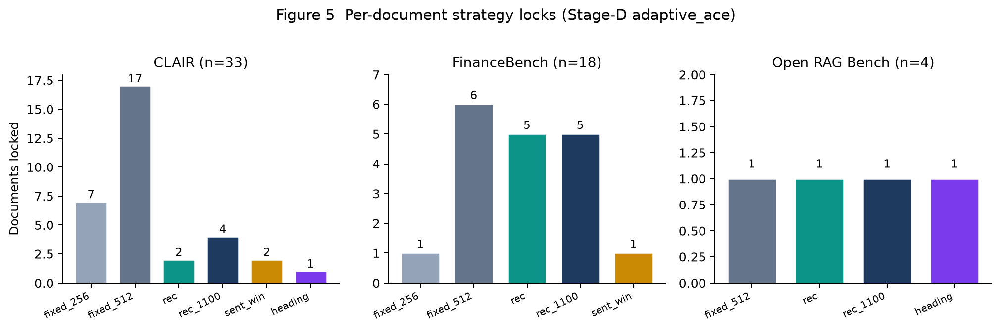
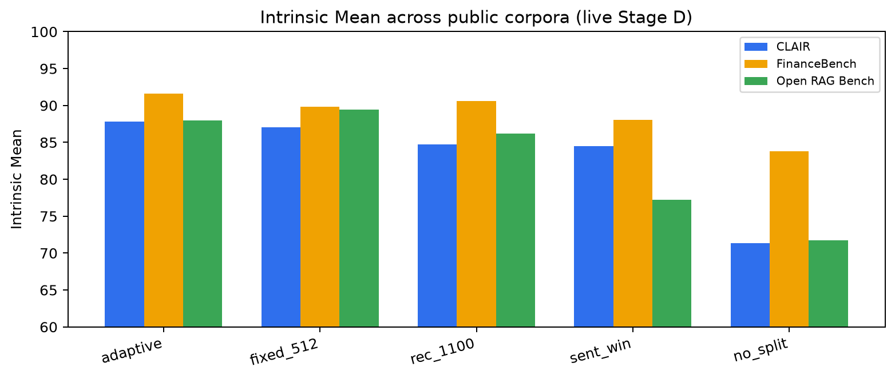

# Adaptive Chunk Engine: Governed Per-Document Chunking Selection for Enterprise RAG

**Anonymous authors**  
Paper under double-blind review for COLING 2027 Industry Track

## Abstract

Chunking is a first-order design choice in enterprise Retrieval-Augmented Generation (RAG), yet production systems often rely on a single global splitter. Building on Adaptive Chunking (de Moura et al., 2026), which selects a splitter **per document** using five intrinsic metrics (RC, ICC, DCC, BI, SC), we present **Adaptive Chunk Engine (ACE)**: an auditable framework for per-document chunking selection in enterprise RAG settings that turns metric-guided selection into a product decision with strategy registries, reproduction manifests, a RAG micro-loop selection objective, dense retrieval with cross-encoder reranking, and a human-triggered optimization gate. Under a production-like stack (`Qwen3-Embedding-8B`, Cohere `rerank-v3.5`, `rag_microloop`, `gpt-4o` judge), ACE reaches **mean** RAG completeness/correctness of **100.0 / 100.0** on a controlled kit (**43/43** answered; vs. **64.2 / 64.6** without rerank), ranks **first** on full-CLAIR intrinsic Mean (**87.8**), and **ties best RAG** on Open RAG Bench (**90.0 / 82.5**) while exposing the failure of non-indexable `no_split` on long PDFs (**35.8 / 26.7**). We report practitioner lessons: ship dual eval lanes, treat Auto as a proposal, and compare ranks within a protocol.

## 1 Introduction

Enterprise RAG pipelines often fail because documents are segmented with a one-size-fits-all splitter, even though retrieval granularity is known to materially affect both retrieval and downstream QA (Chen et al., 2024; Wang et al., 2024). Adaptive Chunking (de Moura et al., 2026) showed that scoring candidates with document-intrinsic metrics and selecting the winner per document improves RAG on CLAIR. Industry deployment adds auditability, human veto, alignment of the eval lane with production retrieval (dense retrieval + cross-encoder reranking; Karpukhin et al., 2020; Nogueira and Cho, 2019), and handling disagreement between intrinsic metrics and RAG feedback (Lewis et al., 2020; Gao et al., 2024; Asai et al., 2024).

COLING Industry Track submissions prioritize practical deployment insight over research novelty. ACE is framed as **enabling infrastructure** for governed chunking selection, including negative/trade-off results when Auto should be overridden—complementing adaptive *retrieval* controllers such as Self-RAG and CRAG (Asai et al., 2024; Yan et al., 2024) with adaptive *chunking* governance.

**Contributions for practitioners:**

1. A productized selection loop (`adaptive_ace`) with Strategy Registry, CanonicalChunk contracts, ReproductionManifests, and optional RAG micro-loop blending.
2. A dual-protocol evaluation kit: cheap offline hashed/lexical gates vs. live embeddings + rerank + LLM-judge RAG.
3. Evidence on CLAIR (full), FinanceBench, and Open RAG Bench that highlights when adaptivity wins—and when humans must override—plus per-document strategy-mix statistics under `rag_microloop`.
4. Operational lessons: rank-order reporting and governance gates.

## 2 Related Work

**RAG foundations.** Retrieval-augmented generation grounds LLM answers in non-parametric memory (Lewis et al., 2020), with related lines including REALM (Guu et al., 2020), FiD (Izacard and Grave, 2021), RETRO (Borgeaud et al., 2022), and Atlas (Izacard et al., 2023). Dense passage retrieval (Karpukhin et al., 2020) and late-interaction multi-vector models such as ColBERT (Khattab and Zaharia, 2020) established the bi-encoder / late-interaction stack used in modern enterprise RAG; sentence-level embedding models (Reimers and Gurevych, 2019) remain the workhorse for chunk indexing. Recent surveys synthesize indexing, retrieval, and generation trade-offs for LLM-era RAG (Gao et al., 2024).

**Chunking and retrieval granularity.** Chunk size and splitter choice are first-order levers: best-practice studies find material sensitivity to chunking heuristics (Wang et al., 2024), while Dense X Retrieval shows that finer units (e.g., propositions) can outperform passage indexing under fixed compute (Chen et al., 2024). Late Chunking embeds long context before pooling per chunk to reduce context loss (Günther et al., 2024). Hierarchical / tree indexing (RAPTOR; Sarthi et al., 2024) and graph-community summarization (GraphRAG; Edge et al., 2024) reorganize document structure for multi-hop or global questions. Industry systems increasingly use LLM-assisted structured chunking (AutoChunker; Jain et al., 2025). Most of these methods still **commit to one segmentation policy**—or one hierarchy—across documents.

**Adaptive retrieval vs. adaptive chunking.** Controllers such as Self-RAG (Asai et al., 2024) and CRAG (Yan et al., 2024) adapt *whether/how* to retrieve and refine evidence at query time. In-context retrieval-augmented LMs similarly treat retrieval as a controllable component (Ram et al., 2023). ACE instead adapts the *offline chunking strategy per document*, then evaluates it under a production-like dense+rerank lane (Nogueira and Cho, 2019). Adaptive Chunking (de Moura et al., 2026) introduced intrinsic metric selection on CLAIR; ACE productizes registries, manifests, a RAG micro-loop, and a human gate when intrinsic ranking disagrees with live RAG.

**Evaluation and benchmarks.** Reference-free / LLM-judge RAG metrics (RAGAS; Es et al., 2024) and automated judge frameworks (ARES; Saad-Falcon et al., 2024) make continuous evaluation practical; MT-Bench / Chatbot Arena established LLM-as-judge methodology more broadly (Zheng et al., 2023). Industry dataset-design work stresses protocol honesty (Teixeira de Lima et al., 2025). We report on FinanceBench (Islam et al., 2023) and Open RAG Bench (Vectara, 2024) alongside full CLAIR, always comparing **ranks within a protocol**.

## 3 Problem Setting and Design Goals

In multi-tenant RAG platforms, chunking is simultaneously a **quality**, **cost**, and **compliance** lever. Legal, financial, and arXiv-style PDFs respond differently to fixed-token, recursive, heading-aware, sentence-window, and no-split strategies.

ACE targets: per-document adaptivity without retraining; auditability via manifests; human veto when RAG regresses; protocol honesty (offline CI ≠ live neural scores; Teixeira de Lima et al., 2025; Es et al., 2024); and retrieval realism (dense top-20 + cross-encoder rerank top-5; Karpukhin et al., 2020; Nogueira and Cho, 2019), consistent with practitioner guidance that chunking and reranking dominate RAG quality (Wang et al., 2024).

## 4 System: Adaptive Chunk Engine

Figure 1 shows the overall workflow of the Adaptive Chunk Engine (ACE), organized into three interconnected stages: strategy selection, retrieval and evaluation, and governance. First, ACE evaluates candidate chunking strategies using five intrinsic metrics (RC, ICC, DCC, BI, and SC). In intrinsic-only mode, the strategy with the highest mean score is selected. In `rag_microloop` mode, ACE shortlists the top intrinsic candidates and combines their intrinsic mean with a micro evidence-coverage score before locking the selected strategy for the document.

Next, the selected strategy is applied to generate CanonicalChunks, which are indexed for dense retrieval (Reimers and Gurevych, 2019; Karpukhin et al., 2020). Evaluation questions are prepared independently and used to assess retrieval performance through dense retrieval, cross-encoder reranking (Nogueira and Cho, 2019), and LLM-based answer quality judging (Zheng et al., 2023; Saad-Falcon et al., 2024). Finally, retrieval regressions are routed to a human review process, where practitioners can retain the current version or revise the chunking configuration and initiate a new experiment—an offline analogue of corrective / reflective RAG control loops (Yan et al., 2024; Asai et al., 2024). This feedback loop makes chunking selection an auditable and human-governed process rather than a fully automated decision.

**Figure 1.** Adaptive Chunk Engine (ACE): Selection → Retrieval → Governance Loop.

**Intrinsic metrics (brief).** Following de Moura et al. (2026): **RC** (retrieval/coverage-oriented completeness of chunks), **ICC** / **DCC** (intra-/document coherence proxies under the live embedder), **BI** (boundary integrity), and **SC** (structural coverage). Selection maximizes their mean, optionally blended with a micro RAG evidence-coverage term.

Candidates evaluated: `fixed_token_{256,512}`, `recursive_text`, `recursive_text_1100`, `sentence_window`, `heading_section`, `no_split`, and `adaptive_ace`.

## 5 Evaluation Protocol

| Protocol | Embeddings / retrieve | Rerank | Judge | Role |
|----------|----------------------|--------|-------|------|
| Offline | Hashed n-grams / lexical | — | Term-coverage | CI / regression |
| Live (primary) | `Qwen3-Embedding-8B` dense | Cohere `rerank-v3.5` | `gpt-4o` | Production-like |

**Score reporting.** Unless noted, RAG **completeness** and **correctness** are **mean scores on a 0–100 scale** over answered questions (LLM-judge JSON; Zheng et al., 2023), not raw question counts. We also report **answered** fractions (e.g., 43/43). Absolute magnitudes are **not** transferable across corpora or offline vs live; compare **ranks within a protocol** (Teixeira de Lima et al., 2025; Es et al., 2024; Saad-Falcon et al., 2024).

| Corpus | Scale reported |
|--------|----------------|
| ACE kit | 6 docs · 43 Q |
| CLAIR | Full 33 docs · ≤3 live QA/doc (98 scored) |
| FinanceBench (Islam et al., 2023) | 18 docs · ≤36 Q (33 scored) |
| Open RAG Bench (Vectara, 2024) | 4 docs · ≤40 Q (12 scored) |

## 6 Results

We report settings that demonstrate ACE’s industrial advantage and omit non-production `no_split` “wins” on short markdown as lead claims. Figure 2 summarizes three advantage highlights; Figures 3–6 add stack progression, cross-corpus RAG, selection mix, and intrinsic Means.

**Figure 2.** ACE-advantage highlights (live stages C/D).

### 6.1 ACE kit — rerank closes the live gap

| Stack | Adaptive mean RAG RC/AC | Answered |
|-------|------------------------:|---------:|
| Embed-small, no rerank | **64.2 / 64.6** | — |
| + Cohere rerank-v3.5 | **100.0 / 100.0** | 43/43 |
| + Qwen3-Embedding-8B | **100.0 / 100.0** | 43/43 |
| + rag_microloop (primary) | **100.0 / 100.0** | 43/43 |

**Figure 4.** Kit stack progression (stages A→C): after rerank, adaptive RAG saturates; embedding upgrade and micro-loop preserve the ceiling while improving governance readiness.

Full pre-aggregation intrinsic metrics (stage C):

| Method | RC | ICC | DCC | BI | SC | **Mean** |
|--------|---:|----:|----:|---:|---:|--------:|
| **adaptive_ace** | 100.0 | 53.23 | 96.48 | 100.0 | 100.0 | **89.94** |
| recursive_text | 100.0 | 53.43 | 96.94 | 98.7 | 100.0 | **89.81** |
| recursive_text_1100 | 100.0 | 53.01 | 95.93 | 100.0 | 100.0 | **89.79** |
| fixed_token_512 | 100.0 | 53.64 | 95.06 | 97.66 | 100.0 | **89.27** |
| sentence_window | 58.33 | 61.43 | 83.96 | 21.35 | 60.69 | **57.15** |

With production-like rerank, adaptive saturates kit RAG (mean 100/100; 43/43 answered); sentence_window remains brittle (70.4/73.1; 25/43 answered).

### 6.2 Public full — CLAIR (33 docs)

| Method | RC | ICC | DCC | BI | SC | **Mean** |
|--------|---:|----:|----:|---:|---:|--------:|
| **adaptive_ace** | 99.92 | 52.12 | 86.85 | 99.13 | 99.62 | **87.8** |
| fixed_token_512 | 100.0 | 49.06 | 86.65 | 99.55 | 100.0 | **87.05** |
| recursive_text_1100 | 99.96 | 47.24 | 76.72 | 99.72 | 100.0 | **84.73** |
| sentence_window | 97.57 | 54.76 | 91.3 | 90.65 | 88.32 | **84.52** |
| no_split | 100.0 | 53.63 | 100.0 | 100.0 | 3.03 | **71.33** |

| Method | Mean RAG RC | Mean RAG AC | Answered |
|--------|------------:|------------:|---------:|
| **adaptive_ace** | **96.57** | **90.5** | 94/98 |
| recursive_text_1100 | 95.96 | 92.93 | 93/98 |
| sentence_window | 76.26 | 73.23 | 71/98 |

Adaptive leads intrinsic Mean and stays near the top of production-viable RAG; sentence_window lags by ~20 RAG points. (`no_split` can still inflate short-context RAG by stuffing full documents—treated as a non-indexer baseline, not a shippable strategy.)

### 6.3 Public full — Open RAG Bench (long PDFs)

| Method | Mean RAG RC | Mean RAG AC | Answered |
|--------|------------:|------------:|---------:|
| **adaptive_ace** | **90.0** | **82.5** | 10/12 |
| fixed_token_512 | 90.0 | 82.5 | 10/12 |
| recursive_text_1100 | 83.33 | 79.17 | 9/12 |
| **no_split** | **35.83** | **26.66** | 3/12 |

On long arXiv PDFs, naive full-doc context **collapses**; adaptive ties best production RAG.

### 6.4 FinanceBench (intrinsic lead; RAG override lesson)

| Method | Mean RAG RC | Mean RAG AC | Answered |
|--------|------------:|------------:|---------:|
| recursive_text_1100 | **99.07** | **93.52** | 32/33 |
| recursive_text | 96.43 | 91.52 | 31/33 |
| **adaptive_ace** | 95.83 | 88.89 | 29/33 |
| sentence_window | 86.48 | 76.85 | 27/33 |

Adaptive intrinsic Mean **91.61** (1st) vs recursive_1100 **90.64**. Live RAG favors larger recursive chunks on this QA mix. This residual gap is exactly why Auto must remain a **proposal** under human review—not a reason to abandon metric selection. Full RC/ICC/DCC/BI/SC rows are in Appendix A.

**Figure 3.** Cross-corpus live RAG: adaptive vs a corpus-specific contrast method (sentence_window on kit/CLAIR; recursive_1100 on FinanceBench; `no_split` on Open RAG Bench).

### 6.5 What does ACE actually lock?

Under `rag_microloop`, ACE does **not** invent a new splitter; it locks a registry strategy per document after blending intrinsic Mean with micro evidence-coverage. Figure 5 shows locked-strategy histograms.

**Figure 5.** Per-document strategy locks (blend winner among micro-loop shortlist).

On CLAIR, locks concentrate on `fixed_token_512` (18/33) with a long tail of recursive/sentence/heading choices. On FinanceBench, locks shift toward `recursive_text_1100` (8/18)—consistent with that corpus’s RAG preference—while still diversifying when metrics disagree. This is the product story: **adaptivity is a governed mixture of known strategies**, not a single global default.

**Figure 6.** Intrinsic Mean across public corpora.

### 6.6 Claim checklist

| Claim | Supported? |
|-------|------------|
| Adaptivity recovers strong splitters | Yes |
| Rerank needed for production-like dense RAG | Yes (kit 64.2→100.0 mean RC) |
| Brittle sentence windows lose | Yes |
| Long-doc RAG needs chunking (not no_split) | Yes |
| Intrinsic = RAG optimum always | **No** (FinanceBench residual) |
| ACE locks a diverse strategy mix | Yes (Fig. 5) |

## 7 Practitioner Lessons

1. Ship two evaluation lanes (offline CI vs live embed+rerank+judge).
2. Align eval with production retrieval; dense-only underestimates adaptive chunking.
3. Report **mean scores** and **answered counts** explicitly—reviewers outside IR may misread `100/100` as question counts.
4. Treat Auto as a proposal when RAG regresses vs a locked baseline.
5. Do not ship `no_split` as an indexer for long documents.
6. Governance (manifests, CanonicalChunk, human gate) is the product surface for compliance.

## 8 Conclusion

ACE extends Adaptive Chunking into an auditable framework for per-document chunking selection, combining intrinsic metric-based selection, production-aligned retrieval evaluation, and human-triggered governance. Intrinsic evidence favors `adaptive_ace`, rerank repairs live dense RAG, and long-document benchmarks expose why governed chunking beats naive full-doc context—while residual disagreements motivate human-triggered optimization.

## Limitations

Live QA is capped per document under API cost controls; FinanceBench/ORB subsets are expanded beyond smoke but not exhaustive. Offline lexical RAG is a CI proxy. LLM-as-judge introduces variance (Zheng et al., 2023; Es et al., 2024). Absolute scores must not be compared across protocols. We do not claim superiority over hierarchical indexing (Sarthi et al., 2024) or graph-community RAG (Edge et al., 2024); ACE governs *which classical splitter to lock* under audit constraints. Large-scale multi-tenant telemetry is out of scope for this Emerging submission.

## Ethical Considerations

ACE evaluates document chunking for RAG. Benchmark subsets may contain sensitive corporate/regulatory text; we use published adapters. Live evaluations call third-party APIs; operators must ensure contractual compliance and PII scrubbing. Human override is intentional for regulated workflows.

## References

Asai, A., Wu, Z., Wang, Y., Sil, A., and Hajishirzi, H. 2024. Self-RAG: Learning to Retrieve, Generate, and Critique through Self-Reflection. In *Proceedings of ICLR*.

Borgeaud, S., Mensch, A., Hoffmann, J., Cai, T., Rutherford, E., Millican, K., van den Driessche, G., Lespiau, J., Damoc, B., Clark, A., et al. 2022. Improving Language Models by Retrieving from Trillions of Tokens. In *Proceedings of ICML*.

Chen, T., Wang, H., Chen, S., Yu, W., Ma, K., Zhao, X., Zhang, H., and Yu, D. 2024. Dense X Retrieval: What Retrieval Granularity Should We Use? In *Proceedings of EMNLP*, pages 15159–15177.

de Moura Junior, P. R., Lelong, J., and Blangero, A. 2026. Adaptive Chunking: Optimizing Chunking-Method Selection for RAG. In *Proceedings of LREC 2026*.

Edge, D., Trinh, H., Cheng, N., Bradley, J., Chao, A., Mody, A., Truitt, S., and Larson, J. 2024. From Local to Global: A Graph RAG Approach to Query-Focused Summarization. arXiv:2404.16130.

Es, S., James, J., Espinosa Anke, L., and Schockaert, S. 2024. RAGAS: Automated Evaluation of Retrieval Augmented Generation. In *Proceedings of EACL (System Demonstrations)*.

Gao, Y., Xiong, Y., Gao, X., Jia, K., Pan, J., Bi, Y., Dai, Y., Sun, J., Wang, M., and Wang, H. 2024. Retrieval-Augmented Generation for Large Language Models: A Survey. arXiv:2312.10997.

Guu, K., Lee, K., Tung, Z., Pasupat, P., and Chang, M. 2020. Retrieval Augmented Language Model Pre-Training. In *Proceedings of ICML*.

Günther, M., Mohr, I., Williams, D. J., Wang, B., and Xiao, H. 2024. Late Chunking: Contextual Chunk Embeddings Using Long-Context Embedding Models. arXiv:2409.04701.

Islam, P., Kannappan, A., Kiela, D., Qian, R., Scherrer, N., and Vidgen, B. 2023. FinanceBench: A New Benchmark for Financial Question Answering. arXiv:2311.11944.

Izacard, G. and Grave, E. 2021. Leveraging Passage Retrieval with Generative Models for Open Domain Question Answering. In *Proceedings of EACL*, pages 874–880.

Izacard, G., Lewis, P., Lomeli, M., Hosseini, L., Petroni, F., Ishii, S., Dwivedi-Yu, J., Joulin, A., Riedel, S., and Grave, E. 2023. Atlas: Few-shot Learning with Retrieval Augmented Language Models. *Journal of Machine Learning Research*, 24(251).

Jain, A., Aggarwal, P., and Saladi, A. 2025. AutoChunker: Structured Text Chunking and its Evaluation. In *Proceedings of ACL 2025 (Industry Track)*, pages 983–995.

Karpukhin, V., Oguz, B., Min, S., Lewis, P., Wu, L., Edunov, S., Chen, D., and Yih, W. 2020. Dense Passage Retrieval for Open-Domain Question Answering. In *Proceedings of EMNLP*, pages 6769–6781.

Khattab, O. and Zaharia, M. 2020. ColBERT: Efficient and Effective Passage Search via Contextualized Late Interaction over BERT. In *Proceedings of SIGIR*, pages 39–48.

Lewis, P., Perez, E., Piktus, A., Petroni, F., Karpukhin, V., Goyal, N., Küttler, H., Lewis, M., Yih, W., Rocktäschel, T., Riedel, S., and Kiela, D. 2020. Retrieval-Augmented Generation for Knowledge-Intensive NLP Tasks. In *Advances in Neural Information Processing Systems*, 33.

Nogueira, R. and Cho, K. 2019. Passage Re-ranking with BERT. arXiv:1901.04085.

Ram, O., Levine, Y., Dalmedigos, I., Muhlgay, D., Shashua, A., Leyton-Brown, K., and Shoham, Y. 2023. In-Context Retrieval-Augmented Language Models. *Transactions of the Association for Computational Linguistics*, 11:1316–1331.

Reimers, N. and Gurevych, I. 2019. Sentence-BERT: Sentence Embeddings using Siamese BERT-Networks. In *Proceedings of EMNLP-IJCNLP*, pages 3982–3992.

Saad-Falcon, J., Khattab, O., Potts, C., and Zaharia, M. 2024. ARES: An Automated Evaluation Framework for Retrieval-Augmented Generation Systems. In *Proceedings of NAACL*, pages 338–354.

Sarthi, P., Abdullah, S., Tuli, A., Khanna, S., Goldie, A., and Manning, C. D. 2024. RAPTOR: Recursive Abstractive Processing for Tree-Organized Retrieval. In *Proceedings of ICLR*.

Teixeira de Lima, R., Gupta, S., Berrospi, C., Mishra, L., Dolfi, M., Staar, P., and Vagenas, P. 2025. Know Your RAG: Dataset Taxonomy and Generation Strategies for Evaluating RAG Systems. In *Proceedings of COLING 2025: Industry Track*, pages 39–57.

Vectara. 2024. Open RAG Bench. Benchmark suite for open-domain RAG evaluation.

Wang, X., Wang, Z., Gao, X., Zhang, F., Wu, Y., Xu, Z., Shi, T., Wang, L., Huang, S., Li, J., et al. 2024. Searching for Best Practices in Retrieval-Augmented Generation. arXiv:2407.01219.

Yan, S., Gu, J., Zhu, Y., and Ling, Z. 2024. Corrective Retrieval Augmented Generation. arXiv:2401.15884.

Zheng, L., Chiang, W., Sheng, Y., Zhuang, S., Wu, Z., Zhuang, Y., Lin, Z., Li, Z., Li, D., Xing, E., Zhang, H., Gonzalez, J. E., and Stoica, I. 2023. Judging LLM-as-a-Judge with MT-Bench and Chatbot Arena. In *Advances in Neural Information Processing Systems*, 36.

## Appendix A: Additional intrinsic metrics (non-counting)

### A.1 FinanceBench intrinsic (%)

| Method | RC | ICC | DCC | BI | SC | **Mean** |
|--------|---:|----:|----:|---:|---:|--------:|
| **adaptive_ace** | 99.84 | 61.21 | 89.34 | 97.64 | 100.0 | **91.61** |
| recursive_text_1100 | 100.0 | 61.87 | 88.27 | 98.8 | 100.0 | **90.64** |
| fixed_token_512 | 99.89 | 53.59 | 84.66 | 98.79 | 100.0 | **89.82** |
| sentence_window | 98.92 | 65.28 | 90.88 | 95.51 | 84.29 | **88.02** |
| no_split | 100.0 | 64.93 | 100.0 | 100.0 | 50.0 | **83.77** |

### A.2 Open RAG Bench intrinsic (%)

| Method | RC | ICC | DCC | BI | SC | **Mean** |
|--------|---:|----:|----:|---:|---:|--------:|
| fixed_token_512 | 100.0 | 60.04 | 87.84 | 99.33 | 100.0 | **89.44** |
| **adaptive_ace** | 99.89 | 56.8 | 84.93 | 98.9 | 99.51 | **88.0** |
| recursive_text_1100 | 100.0 | 53.46 | 78.16 | 99.18 | 100.0 | **86.16** |
| sentence_window | 94.66 | 63.22 | 89.66 | 69.62 | 69.04 | **77.24** |
| no_split | 100.0 | 58.6 | 100.0 | 100.0 | 0.0 | **71.72** |

### A.3 Published Adaptive Chunking CLAIR anchors

| Method | RC | ICC | DCC | BI | SC | **Mean** |
|--------|---:|----:|----:|---:|---:|--------:|
| **Adaptive Chunking** | 99.0 | 68.2 | 88.8 | 99.4 | 99.9 | **91.07** |
| LangChain recursive | 96.1 | 65.6 | 88.8 | 95.0 | 97.7 | **88.62** |
| Sentence | 86.3 | 78.4 | 72.5 | 61.9 | 67.2 | **73.26** |

| Method | Mean RAG RC | Mean RAG AC | Answered |
|--------|------------:|------------:|---------:|
| Adaptive Chunking | 67.7 | 78.0 | 65/99 |
| LangChain recursive | 58.1 | 70.1 | 49/99 |

### A.4 Open RAG Bench kit-style note

Open RAG Bench intrinsic ranks `fixed_token_512` slightly above adaptive on Mean, but live RAG ties adaptive with fixed_512 at 90.0/82.5 while `no_split` collapses—reinforcing rank-within-protocol reporting.
