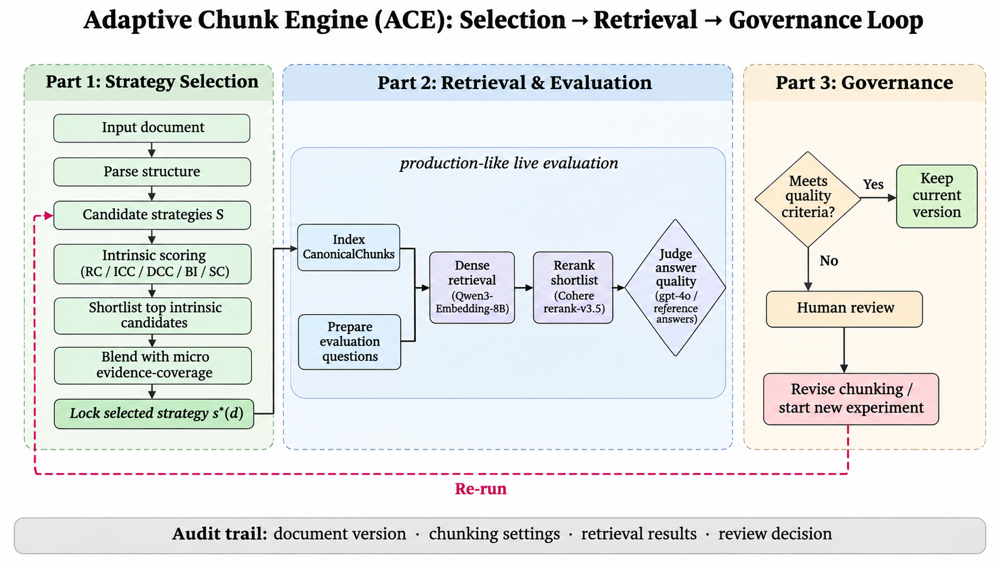
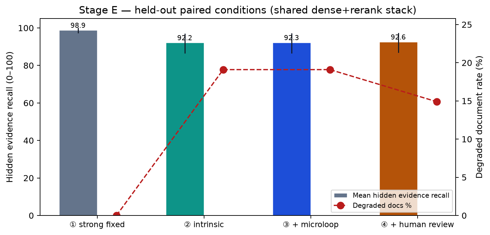

# Adaptive Chunk Engine: Governed Per-Document Chunking Selection for Enterprise RAG

**Anonymous authors**  
Paper under double-blind review for COLING 2027 Industry Track

## Abstract

Enterprise RAG still treats document chunking as a one-size-fits-all preprocessing knob, even though legal notes, 10-K filings, and long scientific PDFs respond differently to fixed-token, recursive, heading-aware, or sentence-window splitters. Building on Adaptive Chunking (de Moura et al., 2026)—five intrinsic metrics and per-document splitter selection—we present **Adaptive Chunk Engine (ACE)**: an auditable productization that turns selection into a reviewable decision artifact (strategy registry, CanonicalChunk contracts, reproduction manifests, RAG micro-loop, dense+rerank lane, and a human approval gate). Our primary claim is not “another leaderboard win,” but that **operators can see why a document was chunked a given way and stop regressions before they ship**.

Under a production-like stack (`Qwen3-Embedding-8B`, Cohere `rerank-v3.5`, `rag_microloop`, `gpt-4o` as an *evidence-support* judge—not an answer scorer), aligning evaluation with rerank raises the controlled kit from **26/43** to **43/43** questions meeting the answerable-evidence criterion (mean judge scores 64.2/64.6→100/100; **7 of 8** Stage-C methods saturate the same ceiling). On public corpora, ACE leads CLAIR/FinanceBench intrinsic Mean and ties best long-document live RAG, while `no_split` collapses on Open RAG Bench. Critically, Stage-D selection and scoring reused the same probe questions; we therefore add **Stage E**, a held-out paired protocol that splits diagnostic vs hidden questions by evidence paragraph and compares four locks on the same documents: strong fixed, intrinsic-only, +retrieval feedback, +human review. Main metrics are **hidden evidence-term recall**, **per-document degradation rate**, paired deltas, and review minutes—not answer accuracy. Public evaluation retrieves only inside gold documents; CLAIR items are title-constructed; FinanceBench supplies preselected evidence pages; Open RAG Bench uses 4 PDFs; FinanceBench held-out requires ≥2 QA (**10/18** docs).

## 1 Introduction

A Retrieval-Augmented Generation (RAG) system pairs an LLM with an external knowledge source so that private or time-sensitive evidence can enter the context window at inference time (Lewis et al., 2020; Guu et al., 2020). Industrial adoption for enterprise search and regulated document QA is now widespread (Gao et al., 2024; Teixeira de Lima et al., 2025). Yet the first irreversible decision is often **how documents are cut into chunks**. Chunk size and splitter choice are first-order levers (Chen et al., 2024; Wang et al., 2024); recent work invents better single algorithms—late contextual embeddings (Günther et al., 2024), hierarchical trees (Sarthi et al., 2024), graph communities (Edge et al., 2024), LLM-assisted structured chunking (Jain et al., 2025). The under-served industrial question is different: given a *registry* of already-deployable splitters, **which strategy should be locked for this document**, under audit, when intrinsic scores and live retrieval feedback disagree?

Adaptive retrieval controllers such as Self-RAG and CRAG (Asai et al., 2024; Yan et al., 2024) decide whether/how to fetch evidence at query time; they do not govern the offline segmentation policy that determines what can be retrieved. Adaptive Chunking (de Moura et al., 2026) showed that scoring candidates with five document-intrinsic metrics and selecting a winner per document improves RAG on CLAIR. We industrialize that idea as **ACE**, with the product contribution focused on **who can inspect and revise a chunking decision, and when that step is worth the cost**.

**Contributions for practitioners.**

1. **Governed selection loop.** Strategy Registry, CanonicalChunk contracts, ReproductionManifests, optional RAG micro-loop blending, and a human approval gate when Auto lags a locked baseline.
2. **Held-out paired evidence (Stage E).** On the same documents, compare ① strong fixed, ② intrinsic-only, ③ +retrieval feedback, ④ +human review, with diagnostic/hidden splits by evidence paragraph; report hidden evidence recall, degradation rate, and review time.
3. **Protocol honesty.** Dual offline/live lanes; LLM-judge scores are evidence-support judgments (question+gold+retrieved spans—no system answer); Mean averages available intrinsic metrics per document then averages documents; ranks only within a protocol.
4. **Override honesty + walkthrough.** FinanceBench shows intrinsic≠live RAG optimum; a 10-K case study traces upload → diagnostic alert → lock change → hidden retest.

## 2 Related Work

**RAG foundations.** Retrieval-augmented generation (Lewis et al., 2020), REALM (Guu et al., 2020), FiD (Izacard and Grave, 2021), RETRO (Borgeaud et al., 2022), Atlas (Izacard et al., 2023); dense retrieval (Karpukhin et al., 2020), ColBERT (Khattab and Zaharia, 2020), Sentence-BERT (Reimers and Gurevych, 2019); surveys (Gao et al., 2024).

**Chunking and granularity.** Best-practice sensitivity studies (Wang et al., 2024); Dense X Retrieval (Chen et al., 2024); Late Chunking (Günther et al., 2024); RAPTOR (Sarthi et al., 2024); GraphRAG (Edge et al., 2024); AutoChunker (Jain et al., 2025). Most still commit to one segmentation policy across documents.

**Adaptive retrieval vs. adaptive chunking.** Self-RAG (Asai et al., 2024), CRAG (Yan et al., 2024), in-context RAG LMs (Ram et al., 2023) adapt query-time retrieval. ACE adapts *offline chunking per document* and evaluates under dense+rerank (Nogueira and Cho, 2019). Adaptive Chunking (de Moura et al., 2026) introduced intrinsic selection; ACE adds registries, manifests, micro-loop, and a human gate.

**Evaluation.** RAGAS (Es et al., 2024), ARES (Saad-Falcon et al., 2024), LLM-as-judge (Zheng et al., 2023); industry protocol honesty (Teixeira de Lima et al., 2025). We use FinanceBench (Islam et al., 2023), Open RAG Bench (Vectara, 2024), and full CLAIR.

## 3 Problem Setting and Design Goals

Each document $d$ is mapped by splitter $s\in\mathcal{S}$ to $C_s(d)$. Enterprise goals: maximize downstream RAG utility, bound $|C_s(d)|$ and audit cost, and preserve a human-readable rationale for the lock. ACE targets: (i) per-document adaptivity without retraining; (ii) auditability via manifests; (iii) human veto on regression; (iv) protocol honesty (offline CI ≠ live neural scores); (v) retrieval realism (dense top-$K_c$ + cross-encoder rerank top-$K$).

## 4 System: Adaptive Chunk Engine

Figure 1 shows ACE in three stages: **strategy selection**, **retrieval & evaluation**, and **governance**.

**Figure 1.** Adaptive Chunk Engine (ACE): Selection → Retrieval → Governance Loop.

### 4.1 Intrinsic scoring and selection

Following de Moura et al. (2026) and our implementation, each candidate $s$ is scored on $C_s(d)$ with: **RC** (References Completeness), **ICC** (Intrachunk Cohesion), **DCC** (Document Contextual Coherence), **BI** (Block Integrity), and **SC** (Size Compliance). Let $\mathcal{M}(s,d)$ be the set of metrics that return a finite value (missing entries—e.g., undefined ICC on empty spans—are skipped). The intrinsic mean is

$$
\mu(s,d)=\frac{1}{|\mathcal{M}(s,d)|}\sum_{m\in\mathcal{M}(s,d)} m(s,d).
\tag{1}
$$

Tables report $\mu$ on a 0–100 percent scale. Corpus-level Mean is the unweighted average of per-document means. In **intrinsic-only** mode,

$$
s^\star(d)=\arg\max_{s\in\mathcal{S}}\mu(s,d).
\tag{2}
$$

### 4.2 RAG micro-loop blending

Intrinsic leadership does not always imply live RAG leadership. In `rag_microloop` mode, ACE shortlists the top-$m$ strategies by $\mu$, then blends each with a cheap evidence-coverage score that does **not** call the LLM judge. For question $q$ with gold evidence $e$ and retrieved chunks $R(q)$,

$$
\mathrm{Cov}(e,R)=\frac{|T(e)\cap T(R)|}{|T(e)|},
\tag{3}
$$

where $T(\cdot)$ extracts alphanumeric terms. Averaging over diagnostic probes yields $\rho(s,d)$. The blended objective is

$$
\mathrm{Blend}(s,d)=\alpha\,\mu(s,d)+(1-\alpha)\,\rho(s,d),\qquad
s^\star(d)=\arg\max_{s\in\mathrm{Shortlist}_m(d)}\mathrm{Blend}(s,d),
\tag{4}
$$

with defaults $m{=}3$ and $\alpha{=}0.55$. On Stage D, this feedback changed the lock away from the strict intrinsic argmax on **14/55** documents (CLAIR 8, FinanceBench 3, Open RAG Bench 3).

### 4.3 Production-like retrieval lane

After locking $s^\star(d)$, ACE materializes CanonicalChunks and indexes them. For query embedding $\mathbf{q}$ and chunk embedding $\mathbf{h}_i$,

$$
\mathrm{sim}(q,c_i)=\frac{\mathbf{q}^\top\mathbf{h}_i}{\|\mathbf{q}\|\,\|\mathbf{h}_i\|},
\qquad
R_{K_c}(q)=\mathrm{Top}\text{-}K_c\big\{\mathrm{sim}(q,c_i)\big\},
\tag{5}
$$

then cross-encoder reranking to $K$ passages (defaults $K_c{=}20$, $K{=}5$). An LLM judge receives the **question, gold evidence, and retrieved spans** and scores whether evidence supports answering (completeness/correctness in $[0,100]$). It does **not** receive a system-generated answer. Reported corpus RAG means average per-document means over **all** scored questions (unanswered count as low/failed), with documents equally weighted.

### 4.4 Governance gate

If live signals regress versus a locked baseline, ACE routes the case to human review—retain, revise $s$, or start a child experiment—matching the product APIs for modification proposals and approval. Candidates: `fixed_token_{256,512}`, `recursive_text`, `recursive_text_1100`, `sentence_window`, `heading_section`, `no_split`, and `adaptive_ace`.

## 5 Evaluation Protocol

| Protocol | Embeddings / retrieve | Rerank | Primary metric | Role |
|----------|----------------------|--------|----------------|------|
| Offline | Hashed n-grams / lexical | — | Term coverage | CI |
| Live Stage D | `Qwen3-Embedding-8B` | Cohere `rerank-v3.5` | LLM evidence-support judge | Production-like fit |
| **Live Stage E (primary)** | same | same | **Held-out evidence-term recall** | Generalization + governance |

**Stage E (held-out paired).** For each eligible document we split QA by evidence-paragraph groups into diagnostic vs hidden sets. Four conditions lock a strategy using **diagnostic material only**, then score **hidden** evidence-term recall under the shared dense+rerank stack:

1. **strong_fixed** — leave-one-out argmax of mean diagnostic Cov over other docs in the corpus;
2. **intrinsic** — Stage-D $\arg\max\mu$;
3. **microloop** — Stage-D shortlist + diagnostic $\mathrm{Blend}$;
4. **human_review** — if microloop diagnostic Cov $<$ strong_fixed $-0.02$, a simulated operator picks $\arg\max$ diagnostic Cov on $\{\mathrm{fixed}\}\cup\mathrm{shortlist}$ and is charged **4 minutes** per alert.

Degradation: hidden Cov drops by $\ge 0.05$ vs strong_fixed. Eligibility: CLAIR 33/33; FinanceBench **10/18** (need ≥2 QA); Open RAG Bench 4/4.

| Corpus | Scale / boundary |
|--------|------------------|
| ACE kit | 6 docs · 43 Q (controlled) |
| CLAIR | 33 docs; title-constructed QA; ≤3 live Q/doc in Stage D |
| FinanceBench | 18 docs Stage D / 10 held-out; preselected evidence pages |
| Open RAG Bench | 4 long PDFs |

Absolute magnitudes are not transferable across corpora; compare **ranks within a protocol**.

## 6 Results

We organize results around the governance question: *after locking, what happens on new questions, and can review catch regressions?* Stage-D leaderboard tables are retained in Appendix A; body Figures 2–3 focus on Stage E and selection honesty.

### 6.1 Stage E — held-out paired main result

**Table 1.** Held-out paired conditions (shared embed/rerank/budget). Mean hidden evidence-term recall (0–100), paired Δ vs strong_fixed (percentage points), degraded-document rate, review overrides, and review minutes per document.

| Condition | Docs | Mean hidden recall | Δ vs fixed (pp) | Degraded % | Overrides | Min/doc |
|-----------|-----:|-------------------:|----------------:|-----------:|----------:|--------:|
| ① strong_fixed | [[E_N]] | [[E_FIXED]] | 0.0 | — | — | 0.0 |
| ② intrinsic | [[E_N]] | [[E_INTR]] | [[E_INTR_D]] | [[E_INTR_DEG]] | — | 0.0 |
| ③ microloop | [[E_N]] | [[E_MICRO]] | [[E_MICRO_D]] | [[E_MICRO_DEG]] | — | 0.0 |
| ④ human_review | [[E_N]] | [[E_HUM]] | [[E_HUM_D]] | [[E_HUM_DEG]] | [[E_OVERRIDES]] | [[E_MIN_DOC]] |

**Figure 2.** Stage E held-out recall and degradation across the four locks.

[[E_NARRATIVE]]

### 6.2 Walkthrough — AMD 2022 10-K

We follow one FinanceBench filing through the product loop (upload → candidates → diagnostic feedback → optional human lock → hidden retest). On Stage D, `sentence_window` led intrinsic Mean (**86.41**) but diagnostic micro coverage lagged (`[[W_BEST_MICRO]]`); ACE locked `recursive_text` (intrinsic **82.37**, micro **[[W_SEL_MICRO]]**)—one of the 14 feedback-driven overrides.

**Table 2.** AMD_2022_10K Stage-E locks and hidden evidence recall.

| Condition | Locked strategy | Hidden evidence recall |
|-----------|-----------------|-----------------------:|
| ① strong_fixed | [[W_FIXED]] | [[W_FIXED_H]] |
| ② intrinsic | [[W_INTR]] | [[W_INTR_H]] |
| ③ microloop | [[W_MICRO]] | [[W_MICRO_H]] |
| ④ human_review | [[W_HUM]] | [[W_HUM_H]] |

[[W_NARRATIVE]]

This is the paper’s intended contribution shape: even when mean gaps are small, a short diagnostic review can change the lock that is shipped to unseen questions.

### 6.3 Kit saturation (evidence-support judge)

| Stack | Adaptive mean judge RC/AC | Answerable |
|-------|--------------------------:|-----------:|
| Embed-small, no rerank | 64.2 / 64.6 | 26/43 |
| + Cohere rerank-v3.5 | 100.0 / 100.0 | 43/43 |
| + Qwen3-Embedding-8B + microloop | 100.0 / 100.0 | 43/43 |

After rerank, **7 of 8** Stage-C methods also reach 43/43 / 100/100; `sentence_window` remains brittle (25/43; 70.4/73.1). These are evidence-support judgments, not answer accuracy.

### 6.4 What ACE locks (Stage D; single source)

**Figure 3.** Per-document strategy locks from Stage-D `adaptive_ace` JSON (CLAIR / FinanceBench / Open RAG Bench).

CLAIR concentrates on `fixed_token_512` (**17/33**) with a long tail. FinanceBench: `fixed_token_512` **6/18**, `recursive_text` **5/18**, `recursive_text_1100` **5/18** (not 8/18—earlier drafts miscounted). Adaptivity is a **governed mixture of known strategies**.

### 6.5 Stage D context (compressed)

On Stage D (selection and scoring share probe questions—an upper bound on fit, not generalization):

- CLAIR intrinsic Mean: adaptive **87.8** (1st); live RAG RC adaptive **96.6** behind only non-shippable `no_split`.
- Open RAG Bench: adaptive ties `fixed_token_512` at **90.0/82.5**; `no_split` collapses (**35.8/26.7**; 3/12 answered).
- FinanceBench: adaptive intrinsic **91.61** (1st) but live RAG trails `recursive_text_1100` (**99.1/93.5**, 32/33 answered vs adaptive 29/33)—the residual that motivates review.

Full method tables and advantage plots: Appendix A.

### 6.6 Claim checklist

| Claim | Supported? |
|-------|------------|
| Held-out protocol separates selection probes from test Q | Yes (Stage E) |
| Review can change locks using diagnostic-only evidence | Yes (alerts/overrides) |
| Rerank needed for production-like dense kit | Yes (26/43→43/43) |
| Intrinsic = live RAG optimum always | **No** (FinanceBench) |
| Figures/tables share Stage-D JSON | Yes (Fig. 3) |

## 7 Practitioner Lessons

1. Ship two evaluation lanes (offline CI vs live embed+rerank).
2. Treat Auto as a **proposal**; budget human minutes for diagnostic alerts.
3. Measure generalization with held-out evidence recall—not only fit on selection probes.
4. Say “answerable evidence / judge score,” not “answer accuracy,” unless answers are blind-graded.
5. Do not ship `no_split` as a long-document indexer.
6. Generate every count in the paper from the same run JSON.

## 8 Conclusion

ACE productizes per-document chunking selection as an auditable workflow: intrinsic metrics propose, retrieval feedback adjusts, and humans can veto. Stage E shows how to measure that workflow on questions the selector did not see; the AMD 10-K walkthrough makes the governance loop concrete. The Industry Track contribution is the operable decision process—not a claim that adaptivity always tops a fixed recursive baseline on every live RAG mix.

## Limitations

Stage E human review is a **simulated operator policy** aligned with product approval APIs, not a timed user study. Primary Stage-E metric is evidence-term recall; we do not blind-grade generated answers in this revision. Public retrieval is restricted to gold documents; CLAIR questions are title-constructed; FinanceBench uses preselected evidence pages; Open RAG Bench evaluates 4 PDFs; FinanceBench held-out covers 10/18 Stage-D docs with ≥2 QA. Offline lexical RAG is a CI proxy. LLM-as-judge variance remains (Zheng et al., 2023; Es et al., 2024). We do not claim superiority over hierarchical/graph indexing (Sarthi et al., 2024; Edge et al., 2024); ACE governs *which classical splitter to lock*.

## Ethical Considerations

ACE evaluates document chunking for RAG. Benchmark subsets may contain sensitive corporate/regulatory text; we use published adapters. Live evaluations call third-party APIs; operators must ensure contractual compliance and PII scrubbing. Human override is intentional for regulated workflows.

## References

Asai, A., Wu, Z., Wang, Y., Sil, A., and Hajishirzi, H. 2024. Self-RAG: Learning to Retrieve, Generate, and Critique through Self-Reflection. In *Proceedings of ICLR*.

Borgeaud, S., Mensch, A., Hoffmann, J., Cai, T., Rutherford, E., Millican, K., van den Driessche, G., Lespiau, J., Damoc, B., Clark, A., et al. 2022. Improving Language Models by Retrieving from Trillions of Tokens. In *Proceedings of ICML*.

Chen, T., Wang, H., Chen, S., Yu, W., Ma, K., Zhao, X., Zhang, H., and Yu, D. 2024. Dense X Retrieval: What Retrieval Granularity Should We Use? In *Proceedings of EMNLP*, pages 15159–15177.

de Moura Junior, P. R., Lelong, J., and Blangero, A. 2026. Adaptive Chunking: Optimizing Chunking-Method Selection for RAG. In *Proceedings of LREC 2026*.

Edge, D., Trinh, H., Cheng, N., Bradley, J., Chao, A., Mody, A., Truitt, S., and Larson, J. 2024. From Local to Global: A Graph RAG Approach to Query-Focused Summarization. arXiv:2404.16130.

Es, S., James, J., Espinosa Anke, L., and Schockaert, S. 2024. RAGAS: Automated Evaluation of Retrieval Augmented Generation. In *Proceedings of EACL (System Demonstrations)*.

Gao, Y., Xiong, Y., Gao, X., Jia, K., Pan, J., Bi, Y., Dai, Y., Sun, J., Wang, M., and Wang, H. 2024. Retrieval-Augmented Generation for Large Language Models: A Survey. arXiv:2312.10997.

Guu, K., Lee, K., Tung, Z., Pasupat, P., and Chang, M. 2020. Retrieval Augmented Language Model Pre-Training. In *Proceedings of ICML*.

Günther, M., Mohr, I., Williams, D. J., Wang, B., and Xiao, H. 2024. Late Chunking: Contextual Chunk Embeddings Using Long-Context Embedding Models. arXiv:2409.04701.

Islam, P., Kannappan, A., Kiela, D., Qian, R., Scherrer, N., and Vidgen, B. 2023. FinanceBench: A New Benchmark for Financial Question Answering. arXiv:2311.11944.

Izacard, G. and Grave, E. 2021. Leveraging Passage Retrieval with Generative Models for Open Domain Question Answering. In *Proceedings of EACL*, pages 874–880.

Izacard, G., Lewis, P., Lomeli, M., Hosseini, L., Petroni, F., Ishii, S., Dwivedi-Yu, J., Joulin, A., Riedel, S., and Grave, E. 2023. Atlas: Few-shot Learning with Retrieval Augmented Language Models. *Journal of Machine Learning Research*, 24(251).

Jain, A., Aggarwal, P., and Saladi, A. 2025. AutoChunker: Structured Text Chunking and its Evaluation. In *Proceedings of ACL 2025 (Industry Track)*, pages 983–995.

Karpukhin, V., Oguz, B., Min, S., Lewis, P., Wu, L., Edunov, S., Chen, D., and Yih, W. 2020. Dense Passage Retrieval for Open-Domain Question Answering. In *Proceedings of EMNLP*, pages 6769–6781.

Khattab, O. and Zaharia, M. 2020. ColBERT: Efficient and Effective Passage Search via Contextualized Late Interaction over BERT. In *Proceedings of SIGIR*, pages 39–48.

Lewis, P., Perez, E., Piktus, A., Petroni, F., Karpukhin, V., Goyal, N., Küttler, H., Lewis, M., Yih, W., Rocktäschel, T., Riedel, S., and Kiela, D. 2020. Retrieval-Augmented Generation for Knowledge-Intensive NLP Tasks. In *Advances in Neural Information Processing Systems*, 33.

Nogueira, R. and Cho, K. 2019. Passage Re-ranking with BERT. arXiv:1901.04085.

Ram, O., Levine, Y., Dalmedigos, I., Muhlgay, D., Shashua, A., Leyton-Brown, K., and Shoham, Y. 2023. In-Context Retrieval-Augmented Language Models. *Transactions of the Association for Computational Linguistics*, 11:1316–1331.

Reimers, N. and Gurevych, I. 2019. Sentence-BERT: Sentence Embeddings using Siamese BERT-Networks. In *Proceedings of EMNLP-IJCNLP*, pages 3982–3992.

Saad-Falcon, J., Khattab, O., Potts, C., and Zaharia, M. 2024. ARES: An Automated Evaluation Framework for Retrieval-Augmented Generation Systems. In *Proceedings of NAACL*, pages 338–354.

Sarthi, P., Abdullah, S., Tuli, A., Khanna, S., Goldie, A., and Manning, C. D. 2024. RAPTOR: Recursive Abstractive Processing for Tree-Organized Retrieval. In *Proceedings of ICLR*.

Teixeira de Lima, R., Gupta, S., Berrospi, C., Mishra, L., Dolfi, M., Staar, P., and Vagenas, P. 2025. Know Your RAG: Dataset Taxonomy and Generation Strategies for Evaluating RAG Systems. In *Proceedings of COLING 2025: Industry Track*, pages 39–57.

Vectara. 2024. Open RAG Bench. Benchmark suite for open-domain RAG evaluation.

Wang, X., Wang, Z., Gao, X., Zhang, F., Wu, Y., Xu, Z., Shi, T., Wang, L., Huang, S., Li, J., et al. 2024. Searching for Best Practices in Retrieval-Augmented Generation. arXiv:2407.01219.

Yan, S., Gu, J., Zhu, Y., and Ling, Z. 2024. Corrective Retrieval Augmented Generation. arXiv:2401.15884.

Zheng, L., Chiang, W., Sheng, Y., Zhuang, S., Wu, Z., Zhuang, Y., Lin, Z., Li, Z., Li, D., Xing, E., Zhang, H., Gonzalez, J. E., and Stoica, I. 2023. Judging LLM-as-a-Judge with MT-Bench and Chatbot Arena. In *Advances in Neural Information Processing Systems*, 36.

## Appendix A: Stage-D tables and prior advantage figures (non-counting)

### A.1 CLAIR intrinsic + live RAG (Stage D)

| Method | RC | ICC | DCC | BI | SC | **Mean** |
|--------|---:|----:|----:|---:|---:|--------:|
| **adaptive_ace** | 99.92 | 52.12 | 86.85 | 99.13 | 99.62 | **87.8** |
| fixed_token_512 | 100.0 | 49.06 | 86.65 | 99.55 | 100.0 | **87.05** |
| recursive_text_1100 | 99.96 | 47.24 | 76.72 | 99.72 | 100.0 | **84.73** |
| sentence_window | 97.57 | 54.76 | 91.3 | 90.65 | 88.32 | **84.52** |
| no_split | 100.0 | 53.63 | 100.0 | 100.0 | 3.03 | **71.33** |

| Method | Mean RAG RC | Mean RAG AC | Answered |
|--------|------------:|------------:|---------:|
| no_split | 98.99 | 94.95 | 97/98 |
| **adaptive_ace** | **96.57** | **90.5** | 94/98 |
| recursive_text_1100 | 95.96 | 92.93 | 93/98 |
| fixed_token_512 | 93.23 | 88.69 | 89/98 |
| recursive_text | 92.73 | 89.7 | 89/98 |
| sentence_window | 76.26 | 73.23 | 71/98 |

### A.2 Open RAG Bench + FinanceBench live RAG (Stage D)

| Method | ORB RC/AC | ORB Ans. | FB RC/AC | FB Ans. |
|--------|----------:|---------:|--------:|--------:|
| adaptive_ace | 90.0/82.5 | 10/12 | 95.83/88.89 | 29/33 |
| fixed_token_512 | 90.0/82.5 | 10/12 | 94.17/89.07 | 28/33 |
| recursive_text | 87.5/83.34 | 10/12 | 96.43/91.52 | 31/33 |
| recursive_text_1100 | 83.33/79.17 | 9/12 | **99.07/93.52** | 32/33 |
| sentence_window | 80.0/73.34 | 9/12 | 86.48/76.85 | 27/33 |
| no_split | 35.83/26.66 | 3/12 | 96.3/91.67 | 31/33 |

### A.3 FinanceBench / ORB intrinsic Means

| Method | FinanceBench Mean | ORB Mean |
|--------|------------------:|---------:|
| adaptive_ace | **91.61** | 88.0 |
| recursive_text_1100 | 90.64 | 86.16 |
| fixed_token_512 | 89.82 | **89.44** |
| sentence_window | 88.02 | 77.24 |
| no_split | 83.77 | 71.72 |

### A.4 Prior advantage figures

**Figure A1–A6.** Radar, domain heatmap, rank trajectories, answered-vs-RAG, FinanceBench trade-off, CLAIR lollipop (unchanged assets under `figures/figA*.png`).

